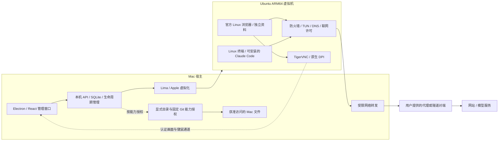

# MuCodeSandbox 项目总览与交接

2026-10-13 最新决定：用户恢复 Linux 优化和本机模式，验收要求为最终可日常使用；不以离线演示替代交付。本机签名 / 系统防护条件尚未具备，原型试验未通过，停止扩大演示；优先交付 Linux 卡顿修复。以下“暂缓 / 暂不改代码”按历史时点理解，最新证据见[本轮进展](docs/linux-performance-2026-10-13.md)。

2026-10-13 最新决定：用户明确“先不推进了，先用 Linux 吧”。**可选本机模式暂缓，继续使用现有 Linux 模式**；方案与只读前置记录保留，本机模式没有进入实现或安装，不自动恢复推进。下文本机模式规划按历史记录理解。

2026-10-13 新增规划：用户要求评估与 Linux 并列的独立本机模式，并明确“先给完整方案，暂不改代码”。已结合 CCBaga 固定提交、Code Sandbox 旧包证据及 Apple 网络扩展文档整理[完整方案](docs/plans/2026-10-13-native-mode-design.md)。现有本机浏览器入口只有资料 / 代理基础，系统级出口保护尚未验收；先验证进程归属与失效断网，再考虑浏览器和逐客户端接入。该要求替代此前全面暂缓 Mac 浏览器的规划边界，但不授权本轮实施、迁移现有 VM 或恢复住宅 / 全天测试目标。

2026-10-13 13:41 更新：**0.4.22 / 33867779e8410cb0** 已安装并在本机核对。总览新增配置 / 实际读数 / 有效期，真实显示宿主授权；三类清理统一范围说明，失败操作显示原因、耗时与检查入口。26项相关单元检查、三组隔离UI及应用包检查通过。更新后经正常核验恢复，三个独立接收端均为166.88.36.199，防护及许可有效；未清理真实资料。偶发网络中断、原黑屏与暂缓的锁屏专项仍按原状态保留。[本轮实现和验证](docs/status-and-recovery-validation-2026-10-13.md)。以下历史内容按各自时点理解。

2026-10-13 11:19补充：10:45真实三端curl28超时隔离停机，11:03通过正常核验恢复，原事件与恢复证明保留。11:15现有Mac到VPS中继启用SSH系统时间日志与PID，正常重载 / 核验通过；回执仍三处166.88.36.199、防护verified / 许可有效。新增只读诊断入口与明确恢复步骤，应用仍为下述0.4.21，环境资料未重置；偶发中断根因仍未知。用户要求先推进其他工作，实际锁屏验收暂待条件。[最新诊断](docs/vps-relay-diagnostics-2026-10-13.md)、[当前2项故障跟进、7项条件记录](docs/current-task-inventory-2026-10-12.md)。下列内容按各自原时点理解。

2026-10-13最新范围：使用现有美国VPS，取消静态住宅、VPS→住宅链路、客户端高级功能、Grok云侧出口和全天验收；耗时设备专项不阻塞本轮。本机 **0.4.21 / cc5b2f659e4a0d63** 已安装，原生卡片提示及Chrome全屏完整显示通过。02:45:29再次接收中断停机，阶段证据确认TLS完成后未获得HTTP响应，未观察到不同IP；08:31:25通过三份166.88.36.199回执正常恢复，原始事件及恢复证明均保留，具体故障源仍未知。标题旁延迟192ms、3/3成功。连接日志表达 / CDP可行性 / CLI更新异常静态路径已限定审查，两个客户端加Chrome完成轻量资源短测；Mac交换空间已用约10.6GiB，维持VM4GiB。大型全面证明、动态全分支 / 重负载和生命周期改造移出本轮；两个独立一致回执及失败停机保留。[当前2项故障跟进、6项条件记录与后续规划](docs/current-task-inventory-2026-10-12.md)、[本轮证据](docs/bounded-review-and-egress-diagnostics-2026-10-13.md)。以下前序记录均按其原时点理解。

2026-10-12 新候选 **0.4.18** 已补防护停机证据、修复步骤和手动恢复，当前等待Mac解锁后的本机替换与核验；实际运行仍为下述0.4.17。不能把已打包当作已安装。见 [实现与验收边界](docs/protection-events-validation-2026-10-12.md)。

2026-10-12 当前更新 **0.4.17**：并行保留浏览器 / 桌面 / 终端连接，受管默认网页与客户端回调，手动文件和文字传输。按用户选择不使用钥匙环，并移除沙箱文泉驿字体。284项检查、隔离界面、实际VM本地回调及传输已取得证据；最终本机窗口和构建见 [本轮限定验证](docs/guest-workspace-handoff-validation-2026-10-12.md)。真实账号及长期网络稳定性尚未验收。下文旧构建按其时点保留。

最新交付 **0.4.16 / c3a052fd19636401**：延迟位于环境名称旁，数值放大；本机实测317ms（3/3）。客户端相同客体用户出口在两个接收端复核为166.88.36.199。272项测试、界面、包与本机核对通过。回执偶发不足问题仍保留，当前已重新核验恢复。[本轮验证](docs/headline-latency-validation-2026-10-12.md)。

0.4.15 / `51945327356e2bdb` 已在本机运行；桌面客户端直接启动，Chrome 独立关闭不结束客户端。272 项测试、UI、包、实际 VM 与本机未登录窗口通过。[本轮验收](docs/desktop-display-separation-validation-2026-10-12.md)。

2026-10-12 前序交付为 **0.4.14 / bfc9a0a5e9b8de1e**，新增用户指定的Clash式线路延迟；实际主值199ms，首次响应1015ms单列。见 [线路延迟验收](docs/unified-line-delay-validation-2026-10-12.md)。下文旧版本结果按其原时点保留。
2026-10-12 最新本机应用为 **0.4.12 / 924f238c29eeba82**，已调整两处排版并恢复环境运行，详情见 [排版验收](docs/desktop-layout-validation-2026-10-12.md)。下面0.4.11线路停止记录保留其原时点，不代表当前采样。
2026-10-12 最新本机应用为 **0.4.11 / 054724502559b855**：已修正停止环境时错误的“未安装”提示。线路当前仍因出口核验回执不足保持关闭，详见 [本次修正报告](docs/desktop-installation-state-validation-2026-10-12.md)。下列0.4.10客户端验收按原时点保留。
更新日期：2026-10-12（台北时间）。最新交付：0.4.10 已在本机运行，新增受管 Grok / Claude 桌面入口及整环境重建；解锁后的本机新入口、两个客户端未登录窗口、关闭重开与完整嵌入 / 全屏显示已核对，本轮限定验收完成。真实账号、付费任务和停止环境的安装状态文案另列待办。前序 VPS 十分钟核验、错 IP 拒绝、断线恢复与完整画面验收保留原时点。
读者：项目使用者、后续开发与验证人员。

这份文档集中说明项目位置、设计方式、文件结构、现状、已完成内容及待办。
当前为 **0.4.22 本机测试版**，整个项目尚未完成。独立 Linux 环境和网络
防护不等于无法识别虚拟机，也不等于保证账户不被封禁。

## 1. 项目与应用的准确位置

| 内容 | 绝对路径 | 用途 / 当前情况 |
| --- | --- | --- |
| 项目根目录 | `/Users/staff/Documents/AIbox/AI/AIbeng/MuCodeSandbox` | 源码、方案、测试脚本和构建输出 |
| 本文 | `/Users/staff/Documents/AIbox/AI/AIbeng/MuCodeSandbox/PROJECT_OVERVIEW.md` | 当前总入口 |
| 源码与文档完整清单 | `/Users/staff/Documents/AIbox/AI/AIbeng/MuCodeSandbox/docs/project-files.md` | 按目录列出实际文件 |
| 文档目录 | `/Users/staff/Documents/AIbox/AI/AIbeng/MuCodeSandbox/docs` | 技术、使用、待办和验证说明 |
| 已安装本机应用 | `/Users/staff/Applications/MuCodeSandbox.app` | 直接使用这个副本 |
| 桌面入口 | `/Users/staff/Desktop/MuCodeSandbox.app` | 快捷链接，指向上述安装副本 |
| 最新构建包 | `/Users/staff/Documents/AIbox/AI/AIbeng/MuCodeSandbox/release/status-overview-candidate/mac-arm64/MuCodeSandbox.app` | 0.4.22构建 `33867779e8410cb0`；本机已安装同构建 |
| 真实运行数据 | `/Users/staff/.mucodesandbox` | VM、配置、数据库及运行组件；不是源码 |
| 环境 / 日志数据库 | `/Users/staff/.mucodesandbox/state.sqlite` | 环境、任务、日志与网络观察记录 |
| 凭据保护密钥 | `/Users/staff/.mucodesandbox/credentials.key` | 私有运行数据，不放入分享材料 |
| Lima 运行组件 | `/Users/staff/.mucodesandbox/tools/lima/bin/limactl` | 管理 Linux VM |
| VM 根目录 | `/Users/staff/.mucodesandbox/lima` | 两个用户 VM 与受保护基础 VM |
| 原始验证材料 | `/Users/staff/Documents/AIbox/AI/AIbeng/MuCodeSandbox/test-results` | 报告、抓包、截图及临时官方审计包 |
| CLI 审计材料 | `/Users/staff/Documents/AIbox/AI/AIbeng/MuCodeSandbox/test-results/client-environment-audit` | 第一轮系统读取 / 发送审计原件 |

源码和说明可以单独交接。真实数据目录、代理配置、凭据密钥、服务私有启动
链接和原始审计记录需要单独处理，不将它们随公开文档一起发布。
当前 Git 仓库未配置远程仓库地址，本文提供的是上述本地项目路径。

## 2. 当前已经安装的版本

| 项目 | 结果 |
| --- | --- |
| 版本 | 0.4.22 |
| 安装构建 | `33867779e8410cb0` |
| 类型 | Apple Silicon Mac 本机桌面测试版 |
| 签名 | 本机临时签名；深度严格检查通过；没有 Apple 正式签名 / 公证 |
| 管理服务 | 当前 `http://127.0.0.1:4367`，仅本机回环地址 |
| 当前后台操作 | 状态采样时没有运行中的应用生命周期任务 |

默认完整适合窗口、固定 2× 桌面以及前序界面修订已更新到这个本机应用。“美国 VPS · 全新环境”08:31:25通过正常核验恢复运行，4核 / 4GiB / 30GiB；正式 Chrome 155.0.8059.39。该独立VM接入自有VPS `166.88.36.199`，未复制旧环境资料；最新三端回执相同，防护 verified、许可有效，原故障与恢复证明均保留，偶发连接中断根因仍待诊断。旧0.4.21副本保留在 `/Users/staff/Applications/.MuCodeSandbox-before-scope-20261013.app`，本轮未重置 / 删除资料。[实际接入与限制](docs/vps-dedione-setup-2026-10-11.md)、[本轮证据](docs/bounded-review-and-egress-diagnostics-2026-10-13.md)。
CLI 环境审计脚本保存在源码项目中，**不是已经增加到桌面应用的常驻审计功能**。
详细原始状态见 [当前状态快照](docs/current-state-snapshot.json)。

当前桌面技术方案见 [Linux 桌面客户端](docs/managed-desktop-design-2026-10-12.md)，竞品新增核查见 [深入拆包对照](docs/competitor-desktop-review-2026-10-12.md)。官方客户端未登录；真实账号由用户最后验证，Cowork等高级功能与云侧出口专项已取消。

## 3. 设计方式与运行分工

采用 **Mac 管理窗口 + 本机管理服务 + 独立 Linux VM** 的方式。

- Mac 上的 Electron / React 窗口负责环境管理、显示浏览器画面和接收键鼠。
- Lima 通过 Apple 虚拟化运行 Ubuntu 24.04 ARM64，网页和开发命令在 VM 内执行。
- 每个 VM 保存自己的磁盘、浏览器资料、项目文件和 Linux 应用配置。
- 严格透明路线使用 Linux 防火墙、TUN、受控 DNS、联网许可及受限转发。
- 宿主文件和有限命令通过单独授权的桥接访问，默认不共享整个 Mac 主目录。
- 浏览器使用官方现成包，保留浏览器自身沙箱；不自编译或修改浏览器内核。



### 网络边界

| 模式 | 作用 | 限制 |
| --- | --- | --- |
| 直连 | 使用普通 VM 网络 | 不提供强制代理防护 |
| 严格应用代理 | 代理配置与客体防火墙共同限制出口 | 不支持代理的程序可能无法联网 |
| 严格透明代理 | TCP / 受控 DNS 经 TUN、指定转发与上游 | 普通业务 UDP / IPv6 阻断；没有直连备用出口 |
| WireGuard | 使用明确配置的隧道对端 | 当前限定范围及真实公网验收见对应专项；不是全部协议保证 |

当前越南环境采用严格透明代理。Mac 其他应用不自动归入该 VM 的防护。
联网许可最多 45 秒，后台约 8 秒复核；故障关闭存在检查 / 到期窗口。
客体 root 完全失陷不属于外部强制网络隔离保证。单次 IP 检测、绿色防护
提示和检测历史不代表每条业务连接都已获得公网来源证明。

### 浏览器与图形

当前为 **Chrome for Testing 156.0.8078.4 / Linux ARM64**，测试发行版，
没有自动更新。日常使用的稳定发行版选择和维护策略仍是待办。
18:01 的官方渠道表 Stable 为 155.0.8059.39；当前构建不是该表列的
稳定版。17:59 的三个页面有限采样未报告 webdriver 自动化标记，程序
匹配已有缓存；见 [当前浏览器观察](docs/browser-observable-audit-2026-10-11.md)。
18:47 的 Google 官方仓库已确认有正式 ARM64 稳定包，接入与资料迁移
尚未执行。18:38 实测 WebGPU adapter=null、媒体设备为空，AudioContext
可运行；主机名仍带 Lima 前缀。完整 35 项修正与下一批方案见
[设备信号复核](docs/device-signal-review-and-plan-2026-10-11.md)。
使用软件图形渲染，未将 Mac 物理显卡直接交给 Linux。

画面按查看区域与 Mac 像素密度调整真实像素。已经实测普通窗口、全屏和
回切；当前采样为 2940×1750、2×，浏览器原生密度匹配。单边上限 8192
像素、总画面上限 1600 万像素。清晰度通过不代表与物理 Linux 指纹等同。

## 4. 两个实际用户环境

| 项目 | 越南线路测试 | MuCodeSandbox 开发环境 |
| --- | --- | --- |
| 环境 ID | `ee85e6f8-043b-4d02-be6e-7a0683c4bde8` | `69716f45-c7b5-4020-bf84-8f8e6a616ea0` |
| Lima 实例名 | `mu-ee85e6f8043b4d02` | `mu-69716f45c7b54020` |
| 当前状态 | 运行中，浏览器已就绪 | 已停止 |
| 分配资源 | 2 CPU / 2 GiB / 10 GiB 磁盘 | 2 CPU / 2 GiB / 20 GiB 磁盘 |
| 线路 | HTTP `127.0.0.1:24897`，严格透明模式 | 直连，严格防护关闭 |
| 防护采样 | active / verified / leaseActive | 停止状态，不作运行中防护判断 |
| 最近出口回执 | `160.191.52.242`，观察窗口内未变化 | 本轮未检测 |
| IP 锁定 | 未启用 | 未启用严格线路 |
| 区域配置 | `en-US` / `Asia/Saigon` | `en-US` / `Asia/Taipei` |
| 持续共享目录 | 无 | 示例目录只读挂入 `/workspace/project` |
| Claude Code 安装 | 日常用户目录中尚未安装 | 本轮未开机检查 |

越南节点是本机专用线路，公网 IP 是否独享、是否住宅及长期声誉尚未验证。
“观察窗口内未变化”不代表全天稳定或所有网站的出口均相同。

VM 磁盘准确位置：

```text
/Users/staff/.mucodesandbox/lima/mu-ee85e6f8043b4d02/disk
/Users/staff/.mucodesandbox/lima/mu-69716f45c7b54020/disk
/Users/staff/.mucodesandbox/lima/mu-protected-base-v1/
```

这些运行 VM 和受保护基础 VM 仍存在。前两块磁盘的 10 / 20 GiB 是逻辑
容量，不等于已占用物理空间，不能直接相加说明 Mac 磁盘使用量。
之前停止的浏览器源码 / 编译路线与这些核心运行 VM 是不同内容。

## 5. 项目文件结构

```text
MuCodeSandbox/
├── PROJECT_OVERVIEW.md         项目总览与交接
├── README.md                  简短入口与开发说明
├── package.json / lock        依赖和命令
├── src/                       React 界面与浏览器显示
├── server/                    本机服务、VM、网络、权限、恢复
├── shared/                    公共类型、版本和校验
├── desktop/                   Electron 入口与本地首页
├── native/                    Mac 原生监测和桥接助手
├── assets/                    图标资源
├── examples/workspace/        示例项目
├── tests/                     单元与 API 测试
├── scripts/                   构建、专项验证与环境审计
├── docs/                      方案、状态、待办、验证与历史
├── test-results/              原始证据和审计临时材料
├── dist/ / dist-server/        构建产物
├── release/                   桌面候选与历史包
└── node_modules/              开发依赖
```

每个实际源码 / 文档文件都列在 [文件清单](docs/project-files.md)。依赖包、
构建产物、测试原件和真实 VM 数据单独说明，不把它们算作应用源码。
按本次清单口径共 **421 个文件**，源码、文档、配置、脚本与资源的逻辑
字节约 **3.82 MiB**（不含清单自身和统计文件）。这不是项目文件夹总磁盘
占用；依赖、应用包、审计二进制和 VM 磁盘另算，详见清单统计。

### 主要模块与文件

| 模块 | 关键文件 | 职责 |
| --- | --- | --- |
| 桌面入口 | [desktop/main.cjs](desktop/main.cjs) | 本机窗口、服务启动、原生能力与关闭清理 |
| 界面 | [src/App.tsx](src/App.tsx)、[src/panels.tsx](src/panels.tsx) | 工作区、环境、使用入口和设置 |
| 视觉布局 | [src/styles.css](src/styles.css)、[src/liquid.css](src/liquid.css) | 适配、按钮、卡片与状态展示 |
| 网络观察 | [src/NetworkActivity.tsx](src/NetworkActivity.tsx)、[server/network-observations.ts](server/network-observations.ts) | 出口回执、连接 / DNS 元数据与可读日志 |
| 浏览器显示 | [src/GuestBrowserView.tsx](src/GuestBrowserView.tsx)、[server/vnc-display.ts](server/vnc-display.ts) | 认证画面、输入和真实分辨率调整 |
| 浏览器运行 | [server/guest-browser.ts](server/guest-browser.ts)、[server/guest-browser-runtime.ts](server/guest-browser-runtime.ts) | 客体进程、启动、配置与连接撤销 |
| 浏览器资料 / 版本 | [server/browser-reset.ts](server/browser-reset.ts)、[server/browser-install-transaction.ts](server/browser-install-transaction.ts)、[server/browser-releases.ts](server/browser-releases.ts) | 资料重置、批准版本、安装 / 恢复 |
| API / 数据 | [server/service.ts](server/service.ts)、[server/store.ts](server/store.ts) | 回环服务、认证、SQLite 与日志 |
| 生命周期 / VM | [server/manager.ts](server/manager.ts)、[server/runtime.ts](server/runtime.ts)、[server/lima-config.ts](server/lima-config.ts) | 创建、启动、停止、资源与实例配置 |
| 网络防护 | [server/network-guard.ts](server/network-guard.ts)、[server/transparent-network.ts](server/transparent-network.ts)、[server/guest-lease.ts](server/guest-lease.ts) | 默认拒绝、透明路径和限时联网许可 |
| 隧道 / 出口 | [server/proxy-transport.ts](server/proxy-transport.ts)、[server/egress.ts](server/egress.ts) | 批准的转发与出口核验；其他隧道模块见文件清单 |
| 宿主访问 | [server/host-bridge.ts](server/host-bridge.ts)、[native/BridgeHelper.swift](native/BridgeHelper.swift) | 有期限的目录能力与固定只读 Git 命令 |
| 共享限制 | [server/guest-mounts.ts](server/guest-mounts.ts)、[server/guest-privileges.ts](server/guest-privileges.ts) | 共享挂载、防提权及账户权限分离 |
| 快照 / 备份 | [server/snapshots.ts](server/snapshots.ts)、[server/backups.ts](server/backups.ts)、[server/disk-recovery.ts](server/disk-recovery.ts) | 离线快照、加密导入导出和恢复事务 |
| 终端 / 任务 | [server/terminal.ts](server/terminal.ts)、[server/guest-task.ts](server/guest-task.ts) | VM 终端、任务时限、取消与进程组清理 |
| 系统监测 | [native/NetworkMonitor.swift](native/NetworkMonitor.swift)、[native/NetworkSnapshot.swift](native/NetworkSnapshot.swift) | Mac 网络状态 / 变化监测 |
| 环境审计 | [scripts/audit-claude-guest.py](scripts/audit-claude-guest.py)、[scripts/audit-claude-report.mjs](scripts/audit-claude-report.mjs) | 无账号系统读取与请求观察、独立复核 |

## 6. 已完成与验证到什么程度

| 能力 | 当前情况 | 证据 / 限制 |
| --- | --- | --- |
| 本机应用、图标与桌面入口 | 已安装可用 | [交付说明](docs/local-test-delivery.md) |
| Linux VM 管理与终端 | 已实现 | 历史流程测试；实际当前状态见快照 |
| 独立浏览器资料与重置 | 已实现 | 清理本地浏览资料，保留 VM / 线路 / 项目；不清除服务端记录 |
| 严格透明网络与 DNS | 已实现，有限定故障验证 | [技术方案](docs/technical-overview.md)、[差距矩阵](docs/gaps-and-validation.md)；不是所有首包与 root 失陷保证 |
| 本地首页、出口回执与日志 | 已更新到本机应用 | [首页验证](docs/browser-home-validation.md)、[网络观察](docs/network-observations-validation.md) |
| Retina 清晰度与按钮样式 | 已更新到 0.4.5 | [画面验证](docs/retina-display-validation.md)、[按钮调整](docs/plans/2026-10-11-history-button-design.md) |
| CLI 安装入口 / 无账号执行 | 已实现入口及测试夹具 | 当前用户 VM 还没安装；真实账号未测试 |
| CLI 直接系统识别审计 | 五轮限定审计完成，继续检查 | 2.1.296、合计 53 条观察 / 9 条校准；读取、标识、工具 / 进程、合成错误及无账号远程门槛，见 [审计报告](docs/cli-environment-audit-2026-10-11.md) |
| 受限宿主桥接与共享 | 已实现并有历史验证 | 当前越南环境无持续共享目录；不等于任意宿主命令 |
| 快照、恢复与加密备份 | 已实现并有限定验证 | 外部共享文件不包含在 VM 快照中；跨设备迁移仍暂缓 |
| 更新 / 故障 / 断线测试 | 有多项历史专项 | 每份结果有自己的包版本，不自动视为 0.4.5 全部重测 |

最近一次软件单元测试记录为 176 项通过，随后按钮样式修订完成构建与
本机 UI 展开 / 收起检查。第一轮 CLI 审计另有独立证据复核。
这次文档整理只验证状态、路径、引用及清单，不重跑 VM 软件验收。

## 7. 前序问题清单与当前目标

下表保留前序审计问题和当时计划，不是当前执行队列。当前目标为现有美国VPS上的基础隔离和正常使用；只做短时基本功能检查与实际故障修复，取消项和耗时专项不再阻塞本轮。最新执行范围以[当前清单](docs/current-task-inventory-2026-10-12.md)为准。

| 优先级 | 问题 / 工作 | 当前证据 | 接下来怎样验证 |
| --- | --- | --- | --- |
| P0 | 持续检查 CLI 的系统读取和发送 | 已证实探测虚拟化 UUID / 容器、读取机器标识和内核；默认遥测含部署类别 | 更多工具 / 错误 / 更新 / 功能分支；每个版本单独绑定结果 |
| P0 | 工具与外接进程的系统读取 | 授权查询可回传 `apple`；工具规则不覆盖所测 Python、MCP 启动或 SessionStart hook | 继续核对进程级权限、其他 hooks / 受管设置 / 插件和敏感查询触发；不承诺完全隐藏虚拟化 |
| P0 | 机器标识与设备标识的关系 | 本轮 Messages device_id 等于配置 userID；同资料保持、换空白资料不同 | 继续检查其他功能 / 标识及派生发送；不能推广到所有身份或服务器关联 |
| P0 | 登录前状态表达 | 防护通过、IP 观察与账户安全是不同判断 | 分开展示范围、检测时间、是否锁定、地区与浏览器渠道 |
| P0 | 多目的端真实出口 | 当前双回执不能证明每条连接 | 公共 / 自有目的端、浏览器与 CLI 对照；条件不足部分暂缓 |
| P1 | 正常稳定浏览器与维护 | 当前主环境使用官方稳定Chrome155 ARM64；受信自动更新尚未交付 | 继续维护批准版本和资料兼容门禁，不静默降级 |
| P1 | CLI / Desktop 正式使用资源 | 当前主环境4CPU / 4GiB，普通未登录客户端已测 | 登录后重任务、并发及长期使用按真实负载另验 |
| P1 | 授权 / 邮件 / 外部链接归属 | 全流程尚未验证 | 无账号跳转夹具确认留在目标 VM，不静默打开本机默认浏览器 |
| P1 | 邮件、同步、重置及旧备份说明 | 浏览器重置不清 CLI，不清服务端历史 | 明确各操作清理范围与旧资料恢复提醒 |
| P2 | 外接屏、多屏及超限显示 | 只实测本机内置 Retina | 不同密度移动、多查看窗口、非整数密度与超限区域 |

完整待办及验证条件集中在 [docs/TODO.md](docs/TODO.md)。不再以持续全面审计、物理机等同或全天验证作为完成门槛；未验证的边界如实保留。

## 8. 已决定暂缓的范围

| 范围 | 当前安排 / 所需条件 |
| --- | --- |
| Claude Desktop 高级 / 账号模式 | 基本Linux客户端已安装并完成无账号验证；Cowork / Computer Use / Dictation专项已取消，账号由用户最后自行验证 |
| Grok云电脑出口 | 专项已取消；本地沙箱规则不自动覆盖厂商云端，保留该边界说明 |
| macOS VM / 本机 Mac 浏览器强制出口 | 当前继续 Linux 路线，暂缓 |
| Apple 正式签名、公证与正式发行 | 缺开发者身份 / 证书；管理员权限不能替代 |
| 应用与浏览器受信自动更新 | 未交付完整自动策略，另排期 |
| 真实休眠 / 唤醒 | 前次管理员认证超时，未实际睡眠；不自动重试 |
| Wi-Fi / VPN 切换 | 影响本机网络，用户暂缓 |
| 完整 24 小时连续验收 | 已取消；只保留历史约45分钟部分结果，不自动重启 |
| 住宅线路、独立公网目的端 | 住宅购买与两段链路已取消；使用现有VPS机房出口，全面逐连接证明移出本轮 |
| 第二台 Mac、真实断电、全部首包捕获 | 外部设备 / 现场条件不足，暂缓 |
| Windows / 其他平台 | 当前范围外 |

详见 [暂缓事项](docs/deferred-validation.md)。停止的浏览器内核、字体及
绘图底层改造不恢复；不为“全部完成”重新下载大型构建源码。

## 9. 现在怎么使用与如何重置

1. 双击桌面 MuCodeSandbox，选择“越南线路测试”。
2. 停止时点“启动”，等待防护核验；进入“浏览器”，关闭状态点“打开浏览器”。
3. 首页查看出口；“日志”查看回执历史和连接元数据；“全屏”按本机密度适配。
4. 想使用 Claude Code 时，进入对应页自行选择安装入口；先处理资源与待验证项。
   当前无需登录账号来查看管理界面、浏览器或审计文档。
5. 结束使用点环境“停止”；仅“关闭浏览器”不停止 VM。

| 操作 | 清理范围 | 保留 / 限制 |
| --- | --- | --- |
| 重置浏览器资料 | 浏览器本地登录、缓存、历史、密码、扩展等 | VM、CLI、项目和线路保留；网站服务器记录不受影响 |
| 删除环境后重新创建 | 原 VM 的本地应用与文件资料 | 应先保留需要的项目 / 备份；不会改变固定公网 IP 或删除网站历史 |
| 恢复快照 / 旧备份 | 将保存的 VM 状态带回 | 可能恢复旧登录 / 标识；不能把恢复结果当作空白新环境 |

使用细节见 [使用指南](docs/user-guide.md)。不要手动删除正在运行的 VM
`disk` 或真实数据目录；清理构建产物不能代替产品里的环境删除流程。

## 10. 开发、证据与文档维护

开发要求、依赖版本和全部命令在 [package.json](package.json)。核心技术为
Electron 44.7.0、React 19.3.0、Vite 8.3.4、TypeScript、Node SQLite、Lima / VZ、
Ubuntu ARM64、noVNC / TigerVNC 与受控网络组件。

正常使用打开已安装 .app，无需运行开发命令。开发使用独立数据目录：

```bash
cd /Users/staff/Documents/AIbox/AI/AIbeng/MuCodeSandbox
MU_DATA_DIR="$PWD/.mu-data" MU_PORT=4369 npm run dev
```

终端打印的私有启动链接含本次授权，自己使用，不贴入分享材料。
源码开发后台与桌面应用不得共用真实数据目录。`npm run build` 构建源码，
`npm test` 运行单元 / API 测试。`test:*` 中的 VM 专项可能创建临时环境、
下载组件、改动夹具或等待测试，不作为普通使用步骤，不自动全部运行。

后续修改依次更新：总览中的当前结论、项目状态、统一待办、对应专项报告。
每项验证注明所用版本、实际执行位置、原始证据和限制。新的源码脚本不
自动代表安装应用已有该功能；旧包测试不自动代表新包重新通过。

## 11. 文档入口

- [所有源码与文档文件](docs/project-files.md)
- [当前项目状态](docs/project-status.md)
- [技术方案总览](docs/technical-overview.md)
- [使用指南](docs/user-guide.md)
- [统一待办](docs/TODO.md)
- [完整文档目录](docs/README.md)
- [CLI 环境审计](docs/cli-environment-audit-2026-10-11.md)
- [Linux 个人电脑目标与边界](docs/linux-personal-computer-equivalence.md)
- [历史 README](README.history-2026-10-11.md)
- [历史阶段状态](docs/project-status-history-2026-10-11.md)

本文记录当前工作事实，不将不可验证的“完全不可识别虚拟机”或“保证不封号”
写成已实现能力。设计方法、已实现代码、实际运行和通过的验证分别记录。

## 0.4.6 最新交付与网络计划

正式ARM64 Chrome已接入并在新资料VM验证；已有156资料继续使用兼容版本。持久主机名、4核/4GiB、固定DPR2、输出音频和美国节点断线关闭测试已完成限定验收，240项单测通过。用户安装路径已更新，旧越南线路/地区及浏览器资料保留，原开发VM仍停止。见 [实施验收](docs/normal-linux-validation-2026-10-11.md)。

用户计划VPS + 静态住宅出站，目前两者都未购买；[搭建与验收方案](docs/network-vps-static-residential-plan.md) 已保存，未进行远程部署或购买。
