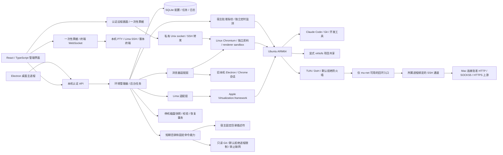
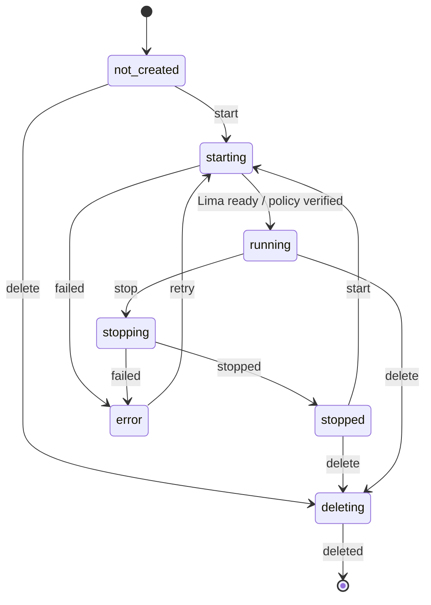

# MuCodeSandbox 架构

2026-10-12 当前更新：0.4.10 / 8053dd4051aba726 已安装，新增官方 Linux ARM64 Claude / Grok 桌面客户端和完整重建。真实未登录进程、资料、网络故障及清理已验；解锁后的最终本机窗口已核对。见 [桌面方案](managed-desktop-design-2026-10-12.md) 与 [验收报告](managed-desktop-validation-2026-10-12.md)。以下为早期架构记录，先前暂缓决定已被本轮桌面授权覆盖。

版本：0.4.0 本机测试版候选。日期：2026-10-09。目标平台：macOS 13.5 以上，Apple Silicon。

当前 0.4.5 安装、准确路径、模块关系与最新 Linux / CLI 目标统一见
[项目总览与交接](../PROJECT_OVERVIEW.md)。本文保留早期详细架构，所列
阶段版本与验证须按记录当时理解，不代表当前包全量验收。

2026-10-11 文档整理：本文件保留模块实现与早期架构决策。当前路线和
边界见 [技术方案总览](technical-overview.md)，执行安排以 [统一待办](TODO.md)
和 [暂缓清单](deferred-validation.md) 为准；文末后续阶段不是自动执行指令。
全部专项设计与验证可从 [文档总目录](README.md) 查阅。

## 目标与当前范围

2026-10-10 路线调整：浏览器采用官方发布二进制，校验下载文件；不维护自行修改的内核。完整浏览器源码、内核补丁和专用构建路线已清理。显式升级先保存资料检查点，验证实际版本、沙箱、网络和绘图后采用，失败则恢复；源码和 1e2831a 包的双版本专项已通过，范围见 [升级记录](browser-upgrade-validation.md)。尚无自动跟随线上版本的升级。特殊上游字体 / 绘图故障保留为兼容性记录，不作为核心隔离交付前置。

2026-10-10 用户曾要求 Claude Desktop 先不做；2026-10-12 重新授权了官方 Linux ARM64 客户端的无账号测试。基本桌面支持已实现，真实账号、Cowork、电脑控制和原生 Mac 集成仍另验。

MuCodeSandbox 在本机创建可持久保存的 Linux 开发环境，并管理独立浏览器会话。第一版提供环境创建和删除、启动和停止、CPU 和内存分配、项目目录只读或可写映射、交互终端、Claude Code 安装入口、HTTP/SOCKS5 代理配置、端口映射、出口检测、运行日志和真实资源采集。

用户自己提供代理或住宅 IP 服务。本应用不销售或内置网络线路，也不生成公网住宅 IP。Claude 登录和付费账户由用户在环境内管理，宿主登录数据不自动复制。

0.4.0 在 Linux sing-box TUN / DoH 基础上增加客体浏览器、受信首启动镜像、开发权限分离、宿主完整性监测、受限文件桥接、离线快照与 HTTPS 加密上游。浏览器和开发任务优先在同一 Linux VM 中运行；Mac 显示窗口只接收画面。Claude Desktop、本机 Network Extension、macOS 客体与 Windows 后端仍未完成，完整差距与验收标准见 [gaps-and-validation.md](gaps-and-validation.md)。

## 系统结构

管理服务只绑定 `127.0.0.1`。桌面外壳直接使用服务模块；命令行可单独启动同一服务。前端没有 Node.js 权限，桌面外壳关闭 nodeIntegration 并启用 contextIsolation 和 sandbox。管理主页须持有私有启动凭据或 HttpOnly 会话 Cookie，不能仅凭通过本地代理访问回环地址取得 API token。API 独立要求 Bearer 与来源校验。客体浏览器窗口只加载本地画面界面；旧本机浏览器的远程网页载入独立 WebContentsView，没有管理界面的 preload 权限。

## 模块与职责

| 模块 | 职责 |
| --- | --- |
| `shared/types.ts` | 前后端数据契约 |
| `server/store.ts` | SQLite 持久化，代理密码 AES-256-GCM 加密，日志脱敏 |
| `server/validation.ts` | 配置和目录验证，代理 URL 构造 |
| `server/lima-config.ts` | 结构化生成 Lima YAML，固定 Ubuntu 镜像摘要，安装与指标脚本 |
| `server/runtime.ts` | Lima 检测、校验安装、生命周期和客体执行 |
| `server/network-guard.ts` | 客体 nftables 规则、开机防护、私有代理环境文件、地区设置与检测 |
| `server/transparent-network.ts` | 固定 sing-box 版本和摘要、TUN 配置、独立服务用户、DoH、安装与停止脚本 |
| `server/manager.ts` | 环境命令、操作串行化、实际状态协调 |
| `server/process.ts` | 无宿主 shell 的命令执行、超时和取消 |
| `server/terminal.ts` | 一次性连接票据、node-pty、远程终端尺寸更新 |
| `server/browser.ts` | 浏览器预览模式的系统 Chrome 管理 |
| `server/guest-browser-runtime.ts` | 官方 Linux Chromium 固定摘要安装、Xvfb / x11vnc、普通 dev 用户与 Chromium sandbox |
| `server/guest-browser.ts` | 私有 SSH 转发、CDP 地区配置与会话生命周期、认证 RFB 转发和撤销 |
| `server/ui-session.ts` | 私有启动链接、管理页面会话 Cookie，防止代理取得 bootstrap 凭据 |
| `server/guest-privileges.ts` | 管理 / 开发用户分离和固定包安装白名单 |
| `server/host-bridge.ts` / `native/BridgeHelper.swift` / `native/host-command.sb` | 短期目录与命令能力、描述符锚定文件操作、只读固定 Git 命令、默认拒绝策略与进程组撤销 |
| `server/snapshots.ts` | 离线磁盘与加密配置快照、HMAC 清单、内容校验和事务恢复 |
| `server/backups.ts` / `server/import-seed.ts` | 密码加密备份、受限归档解析、稀疏导入、认证种子镜像与管理密钥初始化状态 |
| `server/service.ts` | HTTP 接口、来源校验、认证、静态界面服务 |
| `desktop/` | 原生目录选择、独立浏览器窗口和桌面打包 |
| `src/` | React 管理工作区、配置表单、日志、xterm.js 终端 |

## 状态与任务

环境配置和运行状态分开处理。创建配置不立即下载镜像；首次启动才执行 Lima 创建与引导。环境 ID 是随机 UUID，Lima 名称由该 ID 派生，用户显示名称不进入宿主 shell。

每个环境同时只允许一个生命周期任务。任务是持久化记录，输出进入日志表。重启时将中断任务标记失败，并查询 Lima 修正实际环境状态。错误状态保留错误原因，重试需要用户明确操作。

停止、重启或删除环境时先断开相关终端。停止 Linux 环境保留磁盘；删除环境才移除磁盘和自己的浏览器数据。本机共享项目目录不参与删除。

数据目录有独占进程锁，防止两个管理服务同时对同一批环境进行操作。命令使用明确的可执行文件及参数数组；只有客体脚本在 Linux 环境里交给 Bash。后台任务取消后会终止该任务自己的进程组，再检查实际 VM 状态。

离线快照恢复先同步暂存文件和回滚副本，再原子发布经 HMAC 认证的恢复记录，最后替换磁盘及配置。版本 2 记录包含所有回滚副本的大小和 SHA256；未提交恢复在任何目标修改前检查全部副本，损坏时保留记录并阻止启动。SQLite 配置保存后才发布完成记录；回滚也先发布完成记录再清理副本，避免清理中断后把已删副本当作未完成恢复。旧版记录兼容读取但没有新增副本校验能力。

正常生命周期入口在恢复前立即占用环境锁，阻止并发启动、删除、编辑和任务提交；应用退出等待恢复结束。创建或恢复快照在处理遗留事务后重新读取配置，避免磁盘恢复成功却继续使用旧内存配置。真实 VM 的进程强制退出验收见 [快照恢复验证](snapshot-recovery-validation.md)，不代替整机断电和存储设备故障测试。

便携备份从认证快照中选择原始磁盘与必要配置，标准 tar / gzip 经 AES-256-GCM 加密，scrypt 派生密钥，版本头作为认证附加数据。导入先完整验证密文，再用 tar-stream 解析限定的清单和磁盘；拒绝路径、链接、重复项、超额内容和错误 SHA256。零块写为稀疏区域，容量在开始及写入中检查；暂存文件同步后发布新环境，导出以排他方式发布，不能覆盖已有文件。

导入创建新环境 ID、VZ 硬件身份与本机管理密钥，清空宿主共享 / 端口和桥接授权，凭据由新数据目录的密钥重新加密。客体磁盘仍包含原系统和应用资料，不宣称重建全部客体设备标识。经 HMAC 认证的种子记录在首次启动前校验镜像，严格模式要求当前版本的保守开机防护。首次启动替换 mu 的管理公钥并清空 root 旧管理授权，再以新密钥复核，持久记录初始化完成；中途退出的未完成环境拒绝被恢复为可用状态，并先停止后重新初始化。每次后续正常启动再执行授权替换，避免 cloud-init 重新加入旧密钥。[实际迁移范围](portable-backup-validation.md)不包含第二台 Mac 或整机断电。

## 文件与凭据边界

Lima 配置显式写入 mounts；没有继承 Lima 常规模板中的用户主目录共享。共享权限默认只读。选择目录时解析符号链接，拒绝整个用户目录、应用数据目录及密钥和系统配置目录。宿主 SSH agent 转发及自动加载用户 SSH 公钥均关闭。

代理密码在 SQLite 中加密，API 不返回密码，仅返回是否已配置。加密密钥存放在权限 0600 的本地文件，数据根目录权限 0700。这个机制避免配置和日志的直接明文泄露，不能抵御同一 macOS 用户权限下的恶意程序。带密码的 Lima 配置必须供 Lima 读取，同样保存在私有数据目录中。

终端不落盘记录用户键盘输入和终端输出；只记录连接事件，避免把登录令牌或用户文件内容写进应用运行日志。

## 网络边界

Linux 环境由 Lima 提供基础网络；HTTP_PROXY、HTTPS_PROXY、ALL_PROXY 与 NO_PROXY 传给相关客体工具。应用在直连模式关闭宿主代理变量继承。配置中的 localhost 代理在客体执行时转换成 `host.lima.internal`。

默认应用代理只能约束遵守环境变量的程序。开启仅代理联网后，管理器在宿主解析代理域名并固定 IPv4 端点；Linux 的 inet output/forward 链默认丢弃，放行指定代理端口、loopback、SSH 管理回复、DHCP，以及显式共享服务端口的已建立回复。普通程序直接访问外网、发起 DNS 或 IPv6 连接会被丢弃。代理断开时不会打开直连。规则只操作自有的 mu_egress 和 mu_lease 表。

防火墙配置保存在客体，开机服务在 network-pre.target 前应用，systemd-networkd 对该服务具有 Requires/After 依赖。新严格 VM 克隆已封存的受信基础镜像；基础镜像准备时没有用户账号和项目共享，宿主验证配方、HMAC 清单和磁盘摘要。首次用户 VM 开机已经带默认拒绝规则。旧 VM 必须先安装组件、启用保守规则并停机后才能切换。通过应用正常停机时重新装配没有代理端点的保守规则；下次启动验证后才开放当前批准的代理，防止修改配置时沿用旧代理。异常停机后若保存策略仍有旧端点，需要先按原配置启动并通过应用停止才能修改严格配置。

基础镜像同时预置 networkd 的 `ManageForeignRoutingPolicyRules=no` 和 `ManageForeignRoutes=no`，防止软件安装升级或网络服务重启时删除透明代理路由。旧环境在开放开发访问前迁移；新克隆继承相同配置，不重启网络服务以重置首次开机记录。防护版本 4 的开机指纹组合防火墙文件与固定 networkd 策略摘要，并核对文件属主、写权限和合并后有效设置。浏览器组件准备完成后再次检查网络防护，通过后才启动浏览器。

应用代理的严格模式把固定代理和地区配置保存在 root:dev、0640 的客体文件，由命令包装器和登录 shell 读取。宿主命令参数不包含严格模式代理密码。不使用代理的工具会失败。透明模式清空六个代理变量，通过 Linux 路由将 TCP 和 DNS 请求送入 `mu_tun`。独立 `mu-net` 服务使用标准系统 TCP，连接仅自身 UID 可访问的回环端口，经 SSH 交给 Mac 连接批准上游；不保留客体物理网卡直连代理的例外。其他 UDP 与 IPv6 被拒绝，不设置 direct 备用出口。回环限制在开放监听前安装，所属宿主进程退出会关闭 SSH 转发与活动流。见 [连接复用修复](proxy-transport-validation.md)。

透明服务只持有 NET_ADMIN 和 NET_BIND_SERVICE 能力，使用只读系统目录、NoNewPrivileges 和私有临时目录。配置为 root:mu-net、0640；先验证配置再替换和启动。系统 resolved 的本项目配置将 DNS 指向 TUN 内地址；DNS 经指定代理到 Cloudflare DoH，并验证 TLS。Lima 管理网络及指定代理地址排除在 TUN 路由之外，但物理网卡仍受默认拒绝防火墙约束。停止时先切换到无代理、无 TUN 放行的保守规则，再停服务、撤销本项目 resolved 配置和移除凭据。组件由宿主下载，固定 1.14.3 与 SHA-256；安装时保留上游许可证。

开发任务与浏览器使用 dev，无任意 sudo 权限，不能修改规则或读取管理密钥。管理账户与透明网络服务分别具有必要维护权限；固定的 `mu-install` 只允许包白名单。宿主每 8 秒比较批准的内核规则、开机文件、透明配置、路由和 DNS，也检查忙任务所在环境；异常取消任务、撤销终端 / 浏览器 / 桥接并停机。取得客体 root 后仍可修改规则，检测到停机存在时间窗，不能当成客体之外的强制边界。

HTTPS 上游使用 HTTP CONNECT 加 TLS，固定代理 IP 与证书服务器名称分开处理，最低 TLS 1.2，可选单份 CA 证书或系统信任库。不存在跳过证书校验或明文回退选项，所有普通 TCP 与受控 DNS 共用此上游。该模式不把 UDP / IPv6 变为可用，也不保证最终公网出口固定。普通 HTTP / SOCKS5 不提供这一跳的传输加密。

严格透明模式可显式批准最终 IPv4。`server/egress.ts` 在客体专用检测身份的干净环境中访问固定 TLS 测量服务，DNS 经配置的验证 DoH，拒绝无效或超大回应。管理器在发布运行状态和开放浏览器、终端、桥接之前核验，后台定时重测；异常隔离取消现有任务并停机，不自动批准新 IP。异步结果绑定网络配置和生命周期代数，失效结果不得授权。检查入口共享同一在途测量，不以旧成功结果替代新核验。真实公网分流和住宅线路仍需验收；定时查询不是连接级固定出口保证。见 [设计](plans/2026-10-10-egress-design.md) 和 [验收](egress-validation.md)。

防护 v5 的 mu_lease 输入 / 输出链使用内核超时集合，空集合时拒绝业务流量。每次批准有效 45 秒，检查通过才续期；开机先加载空表，持久 dev 服务不能在首次核验前联网。root 专用助手绑定会话与 boot ID，过期或撤销后不能再次打开；宿主核对助手、依赖、规则文件和内核结构。管理、DHCP、检测与隧道外层有明确例外；检测身份不可由开发用户承担，普通回环 DNS 请求须业务许可。旧 gVisor 路径曾保留检测标记，但短期端口复用失败；7395e50 切换系统 TCP 后，业务许可开放前的出口检测发生超时回归。新的检测修复候选仅在启用出口锁定时增加 mu-probe 专用回环 SOCKS 入口，先安装 UID 限制再监听，经同一上游检测，不临时开放业务许可；该入口的 UDP 在 DNS 路由前拒绝。旧硬退出证据仍按 [原包范围](guest-lease-validation.md) 保留，新候选专项与真实休眠 / 切网另验。

桌面浏览器会话使用 Electron session.setProxy。HTTP 代理认证由主进程按浏览器实例提供，远程网页得不到密码。Chromium 暂不支持带认证的 SOCKS5，本应用对此直接报错，避免静默转成直连。浏览器预览模式的系统 Chrome 不支持自动代理认证，会要求改用桌面版。

Linux 浏览器使用固定官方 Chrome for Testing ARM64、私有资料、renderer seccomp 与 PID namespace。Xvfb 不监听 TCP，VNC / CDP 仅客体回环，通过私有 Unix socket 的 SSH 转发访问；显示连接使用短期一次性票据与独立 VNC 密码，不开放任意 CDP 命令 API。CDP 在业务页面执行前应用时区 / 区域，正常导航结束的 Worker 与活跃配置故障分别处理；浏览器自身界面不被调试暂停。页面语言和 Accept-Language 来自客体配置。保留 Linux 与实际渲染器信息，可能软件渲染，未改写 Canvas / GPU / 操作系统。WebRTC 使用 disable_non_proxied_udp，QUIC 关闭，普通 UDP / IPv6 还受到客体防火墙阻断。

网站导航前验证 renderer 与图形进程的各线程保护。严格环境的后台检查及新的受管访问会继续读取运行中的浏览器保护；只读取受管服务进程组，并发请求共用在途检查，关闭会话的迟到结果不能影响替代会话。异常沿用环境隔离停机和画面 / 终端 / 桥接撤销流程。此机制仍是定时采样，不能扩展为瞬时检测、抵抗客体 root 或保护本机 Mac 浏览器。见 [运行中防护验证](browser-monitor-validation.md)。

旧本机浏览器仍使用 Chromium Emulation 与 session.setProxy，其页面 / Worker / iframe 一致性另有测试；它没有 Linux 防火墙保护。本机 Chromium 与实验进程限制的联合测试失败，不能通过关闭 Chromium sandbox 来换取通过。

Linux 使用系统时区文件、生成的 locale、默认 locale 文件及进程环境。桌面浏览器检测从当前网页读取实际值；该检测是功能探针，不是对恶意网页伪造 API 返回值的安全证明。

端口映射只绑定本机 127.0.0.1。默认禁用未明确配置的客体端口自动转发；Lima 的管理 SSH 通道仍存在。

## 非功能需求

- 原始运行组件来源于官方公开发布，安装前固定 SHA-256 校验。
- 第一版不申请管理员权限，不修改系统全局代理。
- UI 显示实际 API 数据；运行状态、资源数字和出口结果不模拟。
- VM 启动和软件安装可以等待较久；用户始终可查看日志并取消。
- 所有界面依赖本地打包资源，不从第三方字体或 CDN 载入界面代码。
- 同一数据目录只能运行一个管理服务；不同数据目录可用于测试。

## 架构决策

### ADR-001：TypeScript 本机服务与 Electron

状态：接受。该 Mac 已有 Node.js 24 和 JavaScript 工具链；共享 TypeScript 契约可以缩短第一版交付时间。选择 Electron 是为了提供原生目录选择、独立 Chromium 会话及直接运行的 macOS 应用。

代价是安装包较大，SQLite Node API 仍需跟随 Node/Electron 版本验证。对比 Go + Wails：后者包体更小，但需要额外安装 Go 工具链并单独处理 Chromium 会话。对比 Rust + Tauri：原生集成清晰，但增加工具链和平台开发成本。当前项目没有远程多租户需求，采用本机模块化单体服务。

交互终端使用成熟的 node-pty 原生组件。命令行服务和 Electron 分别保留独立的原生绑定，避免不同 Node ABI 互相覆盖。安装依赖时只重编译 Electron 专用别名；打包关闭二次自动重编译，并使用展开的应用目录，以保证 PTY 辅助程序可以直接执行。

### ADR-002：Lima VZ 后端

状态：接受。复用官方 Lima 的 VM、SSH 和 virtiofs 管理，使用 Apple Virtualization.framework。没有从被分析的第三方应用复制运行组件、界面代码或后端实现。支持 Apple Silicon 是首版范围，后续通过后端适配接口接 WSL2。

代价是首次启动需要下载约数百 MB 的 Ubuntu 镜像，并依赖 Lima 的启动状态。镜像和运行组件均固定版本或摘要；源文件失效时需要更新版本清单，不能直接绕过校验。

### ADR-003：SQLite 与单环境任务串行化

状态：接受。使用 Node 内置 SQLite，WAL 提供本机事务能力，避免额外原生数据库模块。独占服务锁和每个环境任务锁避免同一环境的启动、删除、修改竞争。日志有数量上限。

代价是多机远程管理不在此存储模型里；未来若增加远程 agent，应明确重新设计认证和权限，不直接开放现有本机端口。

## 后续开发阶段

1. 强制网络出口：核验、客体许可到期与首次业务访问约束已实测，继续真实公网分流、休眠 / 切网与长期故障；补协议矩阵和 Mac 受管进程出口，按明确需求扩展 UDP / IPv6 转发。
2. 运维能力：休眠和网络切换恢复、镜像缓存管理、磁盘扩容、快照断电、备份跨机器与容量故障验收、旧用户迁移。
3. AI 集成：更多 CLI 工具、受限命令能力设计、Claude Desktop 独立配置适配。
4. 分发能力：开发者签名、公证、受信任更新、版本迁移、Windows WSL2。

## 官方参考

- [Lima 安装](https://lima-vm.io/docs/installation/)
- [Lima VZ](https://lima-vm.io/docs/config/vmtype/vz/)
- [Lima 文件共享](https://lima-vm.io/docs/config/mount/)
- [Lima 配置模板](https://github.com/lima-vm/lima/blob/v2.2.0/templates/default.yaml)
- [Electron 安全指南](https://www.electronjs.org/docs/latest/tutorial/security)
- [node-pty](https://github.com/microsoft/node-pty)
- [sing-box 1.14.3](https://github.com/SagerNet/sing-box/releases/tag/v1.14.3)
- [sing-box TUN](https://sing-box.sagernet.org/configuration/inbound/tun/)
