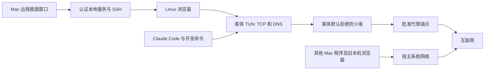

# 功能差距与验收

2026-10-13最新范围优先：现有VPS即可；住宅购买 / 两段链路、客户端高级功能、Grok云端出口和全天验证已取消，耗时工程 / 设备专项移出本轮。以下住宅、Cowork、全天或全面验证的历史待办不恢复执行。现状与精简清单分别见[项目状态](project-status.md)、[当前待办](current-task-inventory-2026-10-12.md)。

2026-10-12 当前更新：0.4.10 的官方 Linux Claude / Grok 桌面客户端与完整环境重建已实现，真实未登录进程、资料、网络断线及清理已验。最终本机窗口已通过限定检查；账号、Cowork 与云任务未验。[最新桌面报告](managed-desktop-validation-2026-10-12.md)。下文旧版本“当前包”按历史时点理解，不作为0.4.10状态。

版本：0.4.0 本机测试版候选。日期：2026-10-11。

当前待办已统一到 [TODO.md](TODO.md)，方案汇总见 [技术方案总览](technical-overview.md)。
本页保留逐阶段证据，旧包段落中的待办不自动恢复执行。全天任务已按用户
要求停止；真实休眠认证超时，未实际睡眠；需要条件的其他验收暂缓。
[后台使用指南](user-guide.md) · [完整文档目录](README.md)。

当前试用包为 9621b0a，修复实际主进程强退后的宿主桥接 SSH 残留。
153 项自动测试 / 构建 / 完整性、实际强退与手动恢复、完整桌面流程
均独立复核通过，九份物理抓包未批准外发 0，资源清理。仅桥接模块
相对 9378141 改变。[实际强退范围](desktop-crash-validation.md)。

当前包 HTTPS / SOCKS5 与出口锁定组合另独立复核通过：先测量再
开放业务许可，认证 / HTTPS 证书故障拒绝、出口变化 / 测量异常撤销、
正确配置恢复与文件保留。十八份客户端物理抓包未批准外发 0，资源
清理。合成回执不是住宅公网实测。[组合范围](egress-probe-validation.md)。

当前包另通过旧共享目录的真实迁移中断 / 重试 / 旧快照恢复专项，
以及实际 Electron 的官方浏览器 153 → 156 升级、恢复和重启专项。
前者无 UI / 网络抓包；后者三份物理抓包未批准外发 0。两项资源清理，
不等于全部旧环境升级完成。[共享迁移](shared-mount-validation.md) ·
[浏览器升级](browser-upgrade-validation.md)。

当前包旧满盘 VM 的界面扩容 / 文件保留 / 普通重启，以及三个实际
维护进程中断点 / 重开门禁 / 界面重试 / 原始较小快照恢复另独立
复核通过。前者三份抓包中首份是旧包开机；后者十三份属于当前包，
未批准外发均为 0，资源清理。旧满盘样本在恢复前由验证器强制停机；
不是全部断电或维护首包验收。[容量](storage-capacity-validation.md) ·
[中断](disk-recovery-interruption-validation.md)。

旧 9378141 修复旧 7395e50 的出口 IP 锁定启动超时。
153 项源码测试 / 构建 / 完整性、实际桌面浏览器 / 无账号 CLI /
文件与固定 Git 授权 / 快照 / 加密导入，以及出口锁定和十分钟持续
网络均独立复核通过；稳定阶段零新增错误，十五份物理抓包未批准
外发均为 0，临时资源清理。

| 剩余项目 | 当前范围与下一步 |
| --- | --- |
| 线路与专项范围 | 当前包 HTTPS / SOCKS5 与出口锁定、受控加密 DNS、实际双 VM WireGuard 浏览器 / CLI / 对端断线 / 重启，以及共享 UI 首次 / 重启 / 改只读均已验；四类隧道故障也已补验，不能扩大为全部故障；公共 / 真实住宅线路未验且暂缓；[隧道](wireguard-validation.md) · [共享](shared-mount-validation.md) |
| 强退与旧环境 | 当前包桌面硬退出、旧共享迁移、双版本浏览器升级、停机旧满盘恢复、三个维护 SIGKILL 点 / 较小快照恢复及选定维护开机网络服务前防护已验；更多整机断电窗口和 hypervisor 全程首包捕获未验；[维护范围](disk-recovery-interruption-validation.md) |
| 全天运行 | 9621b0a 长测程序已有 124 秒短测独立复核；完整全天任务约 45 分钟后按用户要求停止并清理，未满一天，当前暂缓；[报告位置](day-workflow-validation.md) |
| 真实 Mac 切网与休眠 | 切网暂缓；真实休眠已尝试，但管理员认证超时、无实际 Sleep / Wake，未验证且不自动重试；[休眠记录](actual-sleep-validation.md) |
| 外部条件 | 真实住宅线路、第二台 Mac 未提供；正式发行的 Apple 签名 / 公证与自动更新另列 |

Claude Desktop 本轮不做；不恢复浏览器内核编译。Mac 的其他程序不在
Linux VM 防护范围，当前保护也不是对客体 root 入侵的绝对宿主边界。
[本次结果和边界](proxy-transport-validation.md)。
[出口检测修复](egress-probe-validation.md)。

以下为旧包按当时范围保留的记录。

旧试用包 b3b92b6 已实现未完成维护的后台关闭，146 项源码测试、
类型 / 构建和包完整性通过。实际桌面强退、无 UI 迟到启动关闭、维护
网络服务启动前防护与重试六份抓包，以及完整浏览器 / CLI / 宿主授权 /
快照 / 加密导入六份抓包均独立复核通过，未批准外发 0，资源清理。
同包共享目录六份、双 VM 隧道四份、三点维护中断 / 较小旧快照十三份
抓包另独立复核通过，未批准外发均为 0，资源清理。十分钟持续网络
故障恢复通过抓包复核，但断线前四次短请求错误的单独复测又出现
一次连接超时，已保存并独立复核失败证据；稳定性尚未通过，根因未定。
剩余本机工作包括旧满盘 / 迁移 / 升级等候选专项、全天、实际 Mac
切网 / 休眠、更多中断与整机断电；
真实住宅、第二设备及正式发行条件仍另列。

此前 e1caee5 扩容恢复候选已通过旧满盘 VM 的真实 UI 恢复，以及
全新环境 UI 扩容后的完整浏览器 / CLI / 宿主授权 / 快照 / 加密导入，
六份抓包复核未批准外发 0。共享目录首次 / 重启 / 改只读另六份抓包
复核通过；145 项源码测试和包完整性通过。WireGuard 对应包的浏览器 /
CLI、对端断线恢复和重启另四份抓包独立复核通过。
扩容三点实际维护进程中断 / UI 重试 / 较小旧快照恢复十三份抓包，
桌面主进程强退 / 维护网络服务启动前防护六份抓包另已独立复核通过。
剩余本机验收集中在迟到开机关闭的独立监测、更多中断 / 断电、实际
Mac 切网 / 休眠和全天运行；真实住宅、第二设备及正式发行条件
另列。新功能范围冻结，不恢复内核改造或扩展 Desktop / 跨平台。
[当前交付](local-test-delivery.md) · [完整流程](packaged-workflow-validation.md) · [中断范围](disk-recovery-interruption-validation.md)。

此前 45e0b4a 容量修复候选：真实 dev 满盘 / 重启 / UI 满盘快照恢复 /
释放后写入与六份抓包独立复核通过；至少 512 MiB root / 抓包专用组
预留解决旧 cf031a2 的满盘启动失败和记录截断。该包完整浏览器 / CLI /
备份于 18:42 UTC 实测并独立复核通过，五份抓包未批准外发 0，临时
资源删除。共享与隧道未在该旧包复验，旧满盘恢复入口已在 e1caee5 实现。
其他容量 / 整机断电故障不能扩大为已通过。[范围](storage-capacity-validation.md)。

新增宿主网络监测 cf031a2 候选：实际安装包的监测子进程死亡 / 卡死、
真实 VM 停机与浏览器 / 终端 / 授权撤销、手动恢复及五份抓包复核
通过。网络变化门禁和竞态有源码验证，实际 Wi-Fi / VPN 切换仍未
验收。当前同包完整 CLI / 备份、共享目录与双 VM 隧道流程另已实测并
独立复核通过，共十五份抓包未批准外发 0；容量、旧共享迁移、升级
故障及全天仍不能继承旧包全部结果。
当前源码测试 138 项通过。见 [专项与边界](host-network-validation.md)。

用户本轮选择先支持 Linux 虚拟机内的浏览器和 Claude Code。macOS 虚拟机、本机 Network Extension、Claude Desktop 集成保留为后续工作；它们没有因为选择虚拟机路线而被宣称完成。第一轮采用合成登录、本地服务和模拟模型，不使用 Claude 账号或付费请求。

对照对象的官网宣称、安装包静态分析与本项目实测不是同一类证据。没有对参考产品完成故障注入，不凭宣传、函数名或临时签名推断其防护强度，也不提供缺乏依据的“完成百分比”。

2026-10-10 用户明确要求默认使用官方浏览器，除非万不得已不修改浏览器内核。自编译路线、源码补丁、专用脚本和构建材料已移除，未进入现有浏览器；原报告归档保留。网页后来注册字体的特殊后台绘图问题，以及主动让显卡进程崩溃后的原画布恢复问题，保留原失败证据，不能据此宣称普通网页无法使用或会封号。原生补丁 / 编译不再是核心隔离交付前置。后续升级应采用官方版本，验证资料保留、沙箱、防泄漏和基本绘图后再接入；自动升级功能尚未实现。

## 已实现与证据

此前交付包为 `host-power-fix-candidate`（4227377，约 360 MiB），
源码 130 项测试通过。17:04 UTC 实际 Electron / 全新 VM 的完整透明
流程完成，17:05 UTC 复核通过；五份抓包未批准外发 0。另通过实际 VM
休眠 / 仅唤醒通知注入、浏览器 / 终端 / 授权与长连接撤销、手动恢复、
配置路径软链接拒绝、三次开机与五份抓包。修复先授权再首次启动浏览器
的配置目录归属缺陷；旧失败轮保留。配置编辑 / 重开 / 布局与包完整性
另验通过，临时资源已清理。真实 Mac 休眠首包、切网、全天、该包共享 /
隧道 / 容量专项仍待补，不能将旧包全部证据转移。
[交付说明](local-test-delivery.md)、[通知记录](host-power-validation.md)。

此前 `host-power-candidate`（a25ecde）接入休眠 / 唤醒事件，对受保护
Linux 沙箱关闭访问 / 停机并保持手动重新启动。六项针对性、全套 129
项源码测试及实际 Electron 事件注入 / 启动门禁通过；不是新包真实 VM
停机、Wi-Fi 切换或实际 Mac 休眠证明。[休眠记录](host-power-validation.md)。

2651186 包另完成 512 MiB 有界 APFS 实际空间不足和写满的存储专项：
导出 / 导入预检、残缺备份不发布、快照 / 恢复拒绝、替换磁盘后保留
回滚记录与拒绝启动请求、释放空间后恢复通过。测试磁盘及停机列表是
替身，不是 VM / UI / 客体写满或断电验收。[容量记录](storage-capacity-validation.md)。

上一份交付候选为 `local-test-candidate`（2651186，约 360 MiB）。磁盘
容量和完整 DNS 编辑的实际新包 UI 保存 / 拒绝 / 重开 / 移动布局通过；
另于 2026-10-10 16:02:54 UTC（本地次日）完成全新 VM 完整透明流程
独立复核：界面创建 10 GiB 沙箱、浏览器四阶段持久化、无账号 CLI、
宿主授权、快照与加密导入，三次不同开机记录、五份抓包未批准 0、
临时资源删除。46 个后台 / 桌面 / 宿主文件与 b0cd06d 包字节一致。
本轮不包含共享挂载 / WireGuard / 全天、更多升级恢复故障或真实线路，
下列旧包专项仍按原包归属。[交付说明](local-test-delivery.md)。

b0cd06d 本机包于 14:14 UTC 通过实际 Electron / 全新 VM 透明模式
完整流程和独立复核：官方浏览器四阶段持久化、无账号 CLI 真实终端、文件 /
固定 Git 授权、UI 快照 / 加密导入；五份原始物理抓包未批准外发 0，三次
启动记录匹配不同实时 boot ID，资源全部清理。123 项自动测试、十项包内
原生边界测试、构建和签名 / 篡改拒绝通过。旧包双版本、隧道、共享挂载和
其他旧包专项不自动继承。最新包另于 14:16 UTC 通过实际 VM / UI 命令专项：
活动命令下退出 143 毫秒、组内无遗留进程、三份抓包未批准 0，资源清理。
详见 [串联记录](packaged-workflow-validation.md) 与 [命令记录](host-command-validation.md)。

14:31 UTC 新包另通过全新双 VM WireGuard 的实际浏览器 / 官方 CLI 交互、
真实页面请求的对端断线正反对照 / 恢复与重启持久化；四份原始抓包未批准
外发 0，模块 / PNG / 回执 / 启动 ID 独立复核通过，临时资源删除。不是
更多线路故障、长时间、全部 UDP、真实住宅或共享迁移证明。

最新 b0cd06d 包共享目录真实 UI 全新环境专项另于 14:47 UTC 独立
复核通过：首次 / 重启 / 只读变更、有效提权对照与恢复、三个不同开机
记录、六份原始抓包未批准外发 0，全部后台模块 / 桌面入口与截图核验。
临时资源删除；此前截图超时轮保留为失败。14:49 UTC 另完成最新包内
全部后台模块的真实旧环境迁移 / SIGKILL / 拒绝访问和停机 / 重试、
旧磁盘快照恢复后撤销批准并自动修复、文件保留与有效身份对照，独立
复核通过。迁移专项由 Node 调用包内模块，没有 UI / 物理抓包；其他
用户映射、全部中断窗口及断电仍未验收。

15:21 UTC 又通过最新包内模块真实 VM 的十分钟持续数字地址 TCP /
流式任务、代理断线阻断和恢复、networkd 重启 / 续租、转发服务故障
自动停机 / 重启恢复；四份抓包未批准外发 0，原始记录与全部模块
独立复核，临时资源删除。185 次测试代理拒绝的 DoH 请求单列，未
验证正常解析、全天、浏览器或宿主休眠 / 切网。[持续记录](sustained-network-validation.md)。

15:39 UTC 补齐最新包内模块的真实系统解析专项：22 个新域名与本地
加密 DoH，三分钟连续查询、CA / 名称 / 服务关闭三种故障窗口及恢复、
NXDOMAIN / 物理 DNS 绕行拒绝 / networkd 续租通过，六份抓包未批准
外发 0，独立复核和清理通过。没有修改 Mac 信任库；不是浏览器、
公共解析器或全天验收。[域名记录](domain-network-validation.md)。

| 能力 | 实现与实测 | 边界 |
| --- | --- | --- |
| 官方浏览器升级与退出 | 1e2831a 实际 Electron 包通过恢复 / 更新按钮、153 → 156、网站资料持久化及三份原始抓包独立复核；修复活动画面连接导致退出等待，实际退出 652 毫秒 | 无账号、付费 0；旧版预安装通过源码安装器；容量 / 整机断电 / 更多版本另验；[记录](browser-upgrade-validation.md) |
| Linux 沙箱 | Lima / Apple VZ，独立 Ubuntu ARM64 磁盘、资源和生命周期；实际 VM 创建、重启、持久化通过 | 不是 Mac 或 Windows 客体 |
| 整包隧道测试模式 | 内核 SYN 对照与正常生命周期有历史实测；最新 b0cd06d 实际包全新双 VM 的官方浏览器 / CLI 冷安装、TUI 授权 / 中断 / 历史恢复 / 关闭清理、真实页面对端断线失败 / 恢复和重启资料保留通过；四份抓包独立复核 | 单 IPv4 对端，无预共享密钥 / 分流；真实公网 / 住宅、其他 CLI 工具与模式、更多包内故障与长期验证仍待完成；[专项记录](wireguard-validation.md) |
| 本机端口映射 | 修复默认忽略规则未匹配所有地址监听；新 VM 与停止旧 VM 的正常启动迁移实测通过 | 未授权所有地址 / 回环 TCP / UDP 拒绝，明确授权 TCP 映射成功；此项不是授权端口受出口批准 / 许可到期控制的证明；[专项记录](port-forward-validation.md) |
| 文件隔离 | 仅显式映射，默认只读；无宿主 home、SSH agent 共享；实际权限测试通过 | 读写授权允许修改所选项目 |
| 开发用户 | 终端与开发任务以 dev 运行；直接任意 sudo、改 nft / 路由、读取管理密钥的既有测试被拒绝 | 新实际共享目录测试发现 setuid 程序可将 dev 变成管理用户；不能把直接 sudo 拒绝扩展为全部提权路径已封闭。修复及范围见 [专项记录](shared-mount-validation.md) |
| 共享目录提权修复 | 新 VM 首次 / 重启及有效身份对照通过；旧配置无共享迁移、实际 SIGKILL 后拒绝访问 / 停机 / 重试与文件保留通过；源码与新包内模块旧磁盘快照恢复 / 自动维护通过；新增 5558c78 真实 Electron UI 空白目录首建 / 重启、共享及原生有效提权对照、恢复保护、读写改只读与原始抓包独立复核通过 | 所有中断窗口、其他旧用户映射、整机断电与第二台 Mac 仍另验。[专项记录](shared-mount-validation.md) |
| 有限安装 | `mu-install` 仅允许固定包白名单；严格网络下受同一出口约束 | 不是让开发任务任意执行 root 命令；软件包供应链另需持续维护 |
| Linux 透明网络 | sing-box 接管 TCP，系统 DNS 经批准代理到 DoH；实际 curl / Python / Git / Node、软件安装、HTTPS、抓包、故障和重启通过；新增真实 SOCKS5 认证 / 无认证、特殊字符、错误凭据、DNS 名称失败、断线恢复与重启，七阶段抓包独立复核通过 | 普通 UDP、QUIC、IPv6 以阻断代替转发；住宅与商业 SOCKS5 线路、SOCKS 浏览器 / CLI 与包内任务另验；[专项记录](socks-upstream-validation.md) |
| HTTPS 加密上游 | 真实 Linux VM 经验证名称与 CA 的 TLS 代理；双向抓包、错误 CA / 名称 / 凭据、断线与明文正向对照通过 | 只覆盖受控 HTTPS CONNECT 代理；普通 HTTP / SOCKS5 上游仍是明文；不代表完整 VPN 或最终出口固定 |
| 出口核验与变化停机 | 显式批准 IPv4，启动与受管访问重新核验，后台覆盖忙任务；防护 v5 实际 VM 的变化 / 测量失败停机、会话与桥接撤销、五份抓包通过 | 变化回应使用合成 IP；另有激活前真实 TLS 查询和管理器硬退出证据，但仍未证明真实公网分流或休眠；见 [专项验收](egress-validation.md) |
| 严格首次启动 | 无账号、无项目的受信基础镜像准备后封存；b0cd06d 包原首次 / 重启 / 导入启动的三份有界抓包分别匹配实时内核 boot ID，未批准 IP 外发 0，网络服务重启不覆盖记录 | 基础镜像可信引导和宿主组件下载仍使用宿主网络，不包含用户账户或项目；缺少新记录的旧环境需安全停止后再次启动，不能补证旧备份升级前的首次开机 |
| 克隆名称解析 | cloud-init 维护本机回环名称；新克隆、重启及旧环境修复、首次开机抓包回归通过 | 修复 sudo 名称解析警告；不认定它解决了浏览器首次导航超时 |
| 防护完整性 | 宿主保存批准指纹，独立于 UI 定时检查规则、开机文件、透明配置、路由和 DNS | 已验证插入额外放行规则后关闭访问并停机；不是客体 root 在任何瞬间都不可能旁路的证明 |
| 应用故障自动断网 | 防护 v5 的内核短期许可，核验后续期；真实管理进程 SIGKILL、已有 / 新业务连接阻断、重启时持久服务拒绝、正常退出撤销通过；新增实际 ENOSPC 时宿主检查暂停仍自行撤销，并验证恢复 | 写满测试只覆盖许可状态目录；硬退出至上次 45 秒许可截止有窗口；管理 / 检测身份有例外，休眠与切网另验；见 [专项记录](guest-lease-validation.md) |
| Linux 浏览器 | 固定官方 Chromium、dev 用户、认证远程画面；新增软件 WebGL / WebGL2 实际绘图、相关各线程保护及真实关闭保护后的导航前拒绝 / 密码撤销 / 恢复通过；安装期间服务重启已延后，二维画布固定软件绘制。新双 VM 六阶段的字体就绪首次绘制、离线音频、七类上下文 / 资料持久化与 WebGL 通过，28 个 renderer / 365 个线程、6 个图形进程 / 72 个线程保护通过，物理批准代理 29,697 包、未批准 0 | 完整媒体只剩 Worker 晚注册字体未通过；不等同整个项目仅剩这一项。图形与 renderer 的 PID 隔离机制不同；WebGPU / 实际音频硬件和长期性能另验；[媒体](browser-media-validation.md)、[图形防护](browser-gpu-validation.md) |
| WebGPU | 原候选计算成功但画布空白，失败记录保留；新增 Graphite / SwiftShader 候选的真实画布像素、页面 / DedicatedWorker 计算、四阶段浏览器重开 / VM 重启 / 保护故障拒绝和恢复、每阶段 15 次保护采样通过；批准代理 689 包、未批准 0。随后两 VM 六阶段媒体分项 / 保护通过，批准代理 17,872 包、未批准 0，独立原始证据复核完成；三类 Worker 计算、真实画布及绘图期间线程检查另有新增专项 | 尚未加入生产；候选完整媒体仍失败 Worker 晚注册字体，强制设备故障、包内与长期恢复另验，仍须评估单独放开 CPU 适配器限制的影响。共享 Mesa Vulkan 组失去图形隔离，不采用；[专项记录](browser-webgpu-validation.md) |
| 旧本机浏览器 | 独立 Cookie / 登录资料、代理、语言和时区；页面 / Worker / iframe / 请求头一致性通过 | 不受 Linux 防火墙约束；没有本机浏览器系统级出口验收 |
| WebGPU 三类 Worker | 新增 Mac 对照和 Linux 候选四阶段，页面 / DedicatedWorker / 实际同一 SharedWorker 两连接 / ServiceWorker 的计算、纹理及设备一致通过；原生页面画布、保护故障拒绝 / 恢复与 683 批准代理包 / 未批准 0，原始证据独立复核通过 | 原报告没有 Worker 画布或运算期间逐线程采样；后续记录见下一行。尚未加入生产，强制设备故障和长期运行仍需验证，见 [原专项记录](browser-webgpu-worker-validation.md) |
| Worker 真实画布与绘图中保护 | 三类 Worker 控制实际 DOM 转移画布，Linux 候选四阶段共 1,968 帧绘图 / 读回、首帧与移动 PNG 像素通过；20 次原生采样将各 Worker 的 Tracing 线程号经内核 NSpid 对应到同一受保护线程。实际保护故障拒绝 / 恢复通过，物理批准代理 712 包、未批准 0；准确源码 / PNG / 线程 / pcap 独立复核通过，临时 VM 清理 | 五次采样不等于瞬时覆盖，不抵抗客体 root；首次线程编号与 PNG 解码失败记录保留。候选未进入生产 / 包内；字体、强制设备丢失、安全兼容性及长期运行另验，见 [新增专项](browser-webgpu-worker-canvas-validation.md) |
| WebGPU 图形设备故障恢复 | 实际中断 GPU 进程，Linux 四阶段均收到四类原生设备丢失、旧设备拒绝、新设备计算及恢复中线程 / 网络保护通过；批准代理 978 包、未批准 0，独立证据复核有效 | 完整恢复失败：三类 Worker 原画布空白，普通 Mac Chrome 同样复现；释放资源 / 重新申请设备尚不能解决。需修复原生显示通道并验收，重建画布或重开浏览器另属不同范围，见 [失败记录](browser-webgpu-device-loss-validation.md) |
| 已停止的内核研究 | 下载、源码改造和编译尝试已退出当前路线；原实验报告保留，活动脚本、补丁和大体积材料清理 | 没有编译或交付自制浏览器；不是项目已完成的能力，也不是核心交付前置。[归档说明](browser-native-patch-validation.md) |
| 浏览器运行中保护 | 严格 VM 每 8 秒及受管访问时检查受管进程组各线程；两台全新 VM 的源码与包内服务实测未保护图形进程自动拒绝、画面 / 终端 / 桥接撤销、实际停机、恢复和旧授权拒绝通过；批准代理共 31,420 包、未批准 0，独立原始证据复核通过 | 有采样 / 停机时间窗，不能抵抗客体 root；不覆盖本机 Mac 或直接联网模式的后台监测，不替代长期运行 / 实际桌面 UI，见 [专项记录](browser-monitor-validation.md) |
| 无账号实验室 | 真 DNS / STUN 正向对照、合成双登录、请求头与真实 Canvas / GPU 测量、模拟模型流式任务 | 实验室浏览器曾检出 Worker 语言不一致；“检测器通过”不等于被测浏览器一致 |
| 宿主文件桥接 | 按目录和读写能力授权；固定操作、短期凭据、描述符锚定目录、符号链接与路径逃逸拒绝、审计和撤销 | 实际 VM 读、写、撤销和停机撤销通过；没有任意宿主命令接口 |
| 宿主有限命令 | 单独批准的 Git 状态 / 差异 / 最近提交，固定参数、只读项目、禁止联网、8 秒 / 64 KiB 上限及进程组撤销；74fda9a 包八项文件 / 命令边界测试、真实 Electron / VM 授权撤销、重复目录读取和活动命令关闭 203 毫秒通过；三份抓包 147 / 289 / 78 包，未批准 0，独立复核通过 | 关闭阶段包含 1 个已配置端口 9 的连接尝试，不证明业务代理联网；只读固定 Git 能力不等于任意 shell 或系统扩展；Command Line Tools、目录规模 / 硬链接等限制见 [专项记录](host-command-validation.md) |
| 离线 VM 快照 | 停机磁盘 / 配置、HMAC 清单、SHA256、同步落盘、原子恢复记录、回滚预检和环境锁；真实 VM 五类中断通过；源码及 5558c78 包内模块恢复旧不安全磁盘通过；新增 5558c78 Electron UI 创建 / 修改 / 恢复、客体文件与浏览器资料保留、旧桥接授权拒绝通过 | 新包全部事务故障、整机断电和容量故障另验；共享项目与旧本机浏览器不包含；[专项记录](snapshot-recovery-validation.md)、[UI 串联](packaged-workflow-validation.md) |
| 加密环境备份 | AES-256-GCM / scrypt；内容认证后导入稀疏磁盘；新环境 / VZ 身份和管理密钥、不继承宿主授权；实际 Chromium 合成资料独立目录迁移、旧密钥拒绝、首开抓包、重启和真实解密暂存后 SIGKILL 清理 / 重试；新 1b1ef56 包从界面备份真实 VM、导入启动 / 浏览器 / 重启与工作负载抓包通过 | 第二台 Mac、真实服务账户、整盘写满、更多导入提交中断及整机断电未验收；原生文件对话框未操作，本轮在界面输入路径；[专项记录](portable-backup-validation.md) |
| Claude Code | 历史 print / 流式 / 取消与断线重试有实测；最新 b0cd06d 实际包透明代理与 WireGuard 均通过全新 VM 冷安装、真实 TUI 拒绝 / 单次授权、同 PID 中断恢复、退出后历史恢复、关闭清理及独立抓包复核 | 无登录或付费；TUI 使用官方演示模式 / 合成本地网关，首次账号设置、更多工具 / 模式 / 版本和包内完整故障仍待验收；见 [专项记录](claude-client-validation.md) |
| 早期 0.4 本地安装包 | 5f30519 当轮完整临时签名 / 篡改拒绝、STUN / Messages 断线重试模拟、实际 WireGuard VM 浏览器新窗口 / 身份与 Electron 原生 PTY 中真实 CLI 2.1.296 工具 / Ctrl-C 通过；原包透明代理及 v5 迁移另有记录 | 当轮复用同轮源码新建并冷安装完成的 VM；不等于当前 4227377 包全部故障通过；未开发者签名 / 公证 |
| 新备份功能包 | `release/backup-candidate` 的 1b1ef56 包已验完整临时签名、资源篡改拒绝、STUN / Messages / WireGuard 配置及实际包内加密备份往返；新增实际 VM 快照创建 / 界面导出导入、新 VM 浏览器与重启资料保留、物理抓包通过 | 新包 CLI / 快照事务故障另验；原候选的其他记录不能直接归入新包，真实服务账户与第二台 Mac 未使用 |
| 新图形防护包 | `release/graphics-candidate` 的 9a3c9d0 包，保留备份与恢复实现；完整临时签名 / 篡改拒绝、包内依赖与合成备份往返通过；包内已编译服务在全新 VM 的二维绘制、每线程防护、实际隔离关闭后拒绝 / 撤销密码 / 恢复通过，物理代理 490 包、未批准 0，独立证据复核通过 | 不是 WebGL 验收；本轮未操作实际 Electron UI，未将旧包 UI / CLI / 快照事务故障证据转移给新包；[专项记录](browser-gpu-validation.md) |
| 多轮模拟服务包 | `release/tui-candidate` 的 7d6e3ea 包包含多轮 / 合并消息修复，实际包内接口、完整临时签名 / 篡改拒绝和既有依赖检查通过；透明代理与 WireGuard 的实际 Electron 原生终端、全新 VM / CLI 冷安装与基本交互、关闭清理及物理抓包分别通过 | 基本交互通过不等于全部工具 / 模式或全部故障通过；不继承旧包浏览器 / 图形 / 快照事务验收结论 |
| 软件 3D 与二维一致性包 | `release/webgl-canvas-candidate` 的 627da40 包包含软件 GL、二维软件绘制与配方 4；完整临时签名 / 篡改拒绝通过；实际包内已编译服务在全新 VM 的 WebGL / WebGL2、保护故障拒绝 / 撤销 / 恢复与物理抓包通过，批准代理 439 包、未批准 0 | 不是实际桌面 UI、完整媒体、CLI / 快照事务重新验收，也不是 Apple 开发者签名；源码六阶段媒体另有当前配置的证据 |

## 本轮仍需完成

2026-10-11 最新范围调整：用户要求需要额外条件的项目记录先不做。
下表及历史段落中的真实切网 / 休眠、真实住宅、第二设备、物理断电、
全程首包捕获与正式发行条件现为暂缓，不作为当前本机试用等待项。
Mac 扩展、macOS VM 和 Claude Desktop 也暂缓，具体见
[暂缓清单](deferred-validation.md)。仍需继续的是可执行的当前包故障
补测和后台 24 小时运行；暂缓不代表验收通过。

按 Linux 虚拟机浏览器与 Claude Code 的本轮范围，仍需完成下面各项开发和验收；工作组大小不同，不换算完成百分比。新增共享目录权限提升须优先处理。整包隧道首启动、真实浏览器 / CLI 任务、源码透明模式基本 TUI，以及实际包透明代理 / WireGuard 基本 TUI 已通过；完整公网出口约束、休眠 / 切网、其他交互模式、更多工具与包内交付故障仍未完成。

| 优先级 | 差距 | 工作 | 如何验证 |
| --- | --- | --- | --- |
| P0 | 共享目录权限隔离交付 | 首次 / 重启、有效身份对照、旧配置迁移及一个真实 SIGKILL 窗口已验；源码和新包内模块旧快照恢复 / 自动维护通过；新增实际 Electron UI 空白目录首建、权限变更及抓包独立复核通过；继续更多中断及旧用户映射 | 不把一个中断窗口扩展为所有断电路径；新包及源码各自保留实际证据，临时 VM / 数据均清理 |
| P0 | 完整最终出口约束 | 宿主核验与撤销、客体续期失效自行断网及首次核验前持久任务约束已通过；补真实公网分流 / 住宅线路，明确固定上游或连接级保障 | 真实公网 A / B 与不同目的端记录来源；住宅线路另验。定时测量不能等同每个连接的固定出口保证 |
| P0 | 长时间与系统故障 | 已验管理器硬退出、正常退出、客体重启、networkd 重启 / 同地址续租、DNS / 路由损坏、许可目录 ENOSPC 和持续对端断线；补休眠、Wi-Fi 切换、地址变化、整盘写满和长时间运行 | 有正向对照的故障注入；既有与新连接均检查；错误状态不显示为受保护。许可目录写满不能替代整盘恢复 |
| P1 | 代理和 DNS 兼容 | 可配置 DoH，HTTPS 名称 / CA / 认证和 SOCKS5 认证 / 无认证 / 特殊字符 / 错误凭据 / DNS 名称失败已实测；补代理域名地址变化、商业线路、SOCKS 浏览器 / CLI 和包内任务 | 实际协议与认证测试；DNS / TLS 故障时不转为宿主或物理网卡直连；本地协议通过不替代真实线路 |
| P1 | 官方浏览器升级与兼容 | 同版本安装事务五处 SIGKILL / 校验拒绝已验；真实官方 153 → 156、资料改动后失败回退、检查点 SIGKILL、成功升级 / 重启及原始抓包独立复核通过；新增 1e2831a 实际 Electron 包全新 VM 的更新 / 恢复、三类异常拒绝、重启持久化、活动画面下退出及抓包复核通过。继续更多中断 / 容量、性能和其他版本 | [升级记录](browser-upgrade-validation.md)。旧版预安装使用源码安装器；源码移动 UI 专项使用模拟状态。管理命令 SIGKILL 后观察以超时返回，立即退出行为另验。特殊字体 / GPU 恢复与原媒体失败保留，不能关闭 sandbox 换取通过 |
| P1 | 地区与出口核验 | 显示实测出口和配置的关系，处理数据库结果不确定性 | 不同出口配相反时区能提示事实；不声称某个语言或时区本身可证明住宅出口 |
| P1 | 数据迁移与恢复 | 已验真实恢复进程中断、解密暂存后 SIGKILL、实际 Chromium 合成登录和网站数据的备份迁移；补旧 VM 用户映射和读写共享权限迁移、容量故障、更多提交中断、实际第二台 Mac、真实服务账户和整机断电 | 旧目录 UID 写入、实际容量不足、跨机器恢复和升级演练；已验密码 / 密文损坏 / 截断 / 恶意归档拒绝；不回滚宿主项目或恢复已失效授权 |
| P1 | 客户端与交付验收 | 最新 b0cd06d 包完整透明流程及 WireGuard 实际浏览器 / CLI、对端断线恢复与重启均通过；补首次账号设置、更多工具子进程 / 模式与版本、包内截断 / 超时 / 全部故障、全新 Mac、旧数据升级 | 不登录或付费；断线后观察重试，不能将主动取消写成自然失败。新包完整 UI 结果见 [串联验收](packaged-workflow-validation.md) 和 [隧道专项](wireguard-validation.md)；无挂载环境不证明项目挂载权限，历史其他故障不转移到新包 |

## 后续范围

| 项目 | 状态 | 后续工作与验收 |
| --- | --- | --- |
| Mac 受管进程强制出口 / Network Extension | 实验性进程限制已测；Electron 与独立 Mac Chrome 联合实验均失败，功能未开放；系统扩展未实现 | 必要单实例 Unix socket 绑定问题排除后，独立 Chrome 仍出现内部 sandbox 初始化失败；不能关闭 renderer sandbox 来换取通过。[实际范围](mac-browser-enforcement-validation.md)。正式 Network Extension 需要开发者账号、正确证书 / 权限和用户启用，加载后仍须逐协议和故障抓包；临时签名不能授予该权限。其他宿主边界也须有实际证据 |
| macOS 虚拟机 | 未实现 | 系统镜像、恢复与安装流程、桌面显示、资源配置；客体同样需要单独验证网络边界 |
| Claude Desktop | 用户于 2026-10-10 明确要求先不做，移出本轮待办 | 不开发、不接入现有账号；后续由用户重新安排 |
| 正式分发 | 本机包资源封装与终端 / 浏览器实测通过；未开发者签名、公证 | 正式签名 / 公证、更新校验和分发渠道；常规冷安装与旧数据升级列在本轮客户端与交付验收中 |
| Intel / Windows | 未实现 | 各平台后端和权限设计，重复文件、网络、首启动与故障验收 |

临时签名不需要购买开发者账号，也不增加 Linux 防火墙强度；当前完整应用封装由独立签名校验和篡改实测证明。正式开发者账号属于本机 Network Extension 和正式分发路线的条件，不是当前 Linux VM 路线的前提。管理员权限与开发者账号不是同一件事。

## 网络范围

Linux 浏览器中的网页连接由 Linux 发起，Mac 显示窗口只接收画面。配置为直接联网的 VM 不提供代理强制出口。配置严格透明网络时，普通 TCP 和系统 DNS 经批准代理；其他 UDP / IPv6 阻断。DNS 的专用接管不代表支持所有 UDP。

管理 SSH 回复与 DHCP 是显式例外；宿主对代理域名的解析、镜像和组件下载也不在客体防火墙范围。桥接通过既有 SSH 的 Unix socket 转发，不新增加任意外联例外。客体 root 可以修改规则；宿主监测在检测到异常后撤销终端和授权并停机，不能保证 root 拆规则到停机之间没有时间窗口。

批准的代理端点不等于固定最终公网 IP。HTTPS 模式已验证 VM 到代理端点的 TLS 加密、名称和证书检查及失败阻断；普通 HTTP / SOCKS5 上游未启用传输 TLS。当前阻断普通 UDP / IPv6，不等于完整内层 VPN。两篇网络文章的逐项对照、具体差距和无账号验收方法见 [网络文章对照](network-posts-comparison.md)。

## 如何复现

| 入口 | 覆盖范围 | 报告 |
| --- | --- | --- |
| `npm test` | 配置 / 认证 / 密码、生命周期、资源、真实 PTY、快照回滚、桥接路径与撤销、浏览器下载校验等单元和局部集成测试 | 终端输出 |
| `npm run test:lab` | DNS / STUN 正向对照、合成登录、跨上下文检测器、模拟模型和工具任务 | `test-results/account-free-lab.json` |
| `npm run test:native-lab` | 旧本机浏览器页面 / Worker / iframe / 请求头一致性 | `test-results/native-lab.json` |
| `npm run test:security` | 新严格 VM 首次启动抓包、开发权限、认证代理、TCP / DNS / 有路由 IPv6、重启和规则篡改停机 | `test-results/network-security.json` |
| `npm run test:transparent` | 实际 VM 普通程序、系统 DNS、HTTPS、安装、抓包、代理与隧道故障、重启和主动切回直接网络 | `test-results/transparent-network.json` |
| `npm run native:build` 后 `npm run test:bridge` | 实际 VM 桥接读写、拒绝路径逃逸、撤销与停机 | `test-results/host-bridge.json` |
| `npm run test:snapshots` | 实际离线磁盘恢复、五类进程中断后的正常生命周期恢复、磁盘 / 配置一致、宿主项目保留、损坏拒绝 | `test-results/snapshots.json`；含所测源码 SHA256，不是实际整机断电 |
| `npm run test:backups` | 实际严格 VM 加密导出、不同管理密钥和数据目录导入、数据保留、旧密钥实际登录拒绝、首次开机抓包和重启 | `test-results/portable-backups.json` 与 `backup-import-first-boot.pcap`；不是实际第二台 Mac 或真实浏览器登录迁移 |
| `npm run test:backups-browser` | 全新严格 VM 的真实 Chromium 写入合成 HttpOnly Cookie、localStorage / IndexedDB，备份导入与重启后不重新登录即恢复，另复跑密钥 / 首开防护 | `portable-backup-browser.json`、`backup-browser-first-boot.pcap` 和三阶段截图；不是第二台 Mac 或真实服务账户 |
| `npm run test:backups-packaged` | 同轮全新源 VM / 浏览器冷安装和独立目录迁移；实际 1b1ef56 桌面包从界面备份 / 导入真实 VM，启动浏览器 / 重启、数据保留和真实画面、批准代理正向对照与物理抓包 | `portable-backup-packaged.json`、`packaged-backup-browser.json`、两份 pcap 和六阶段截图；本轮输入路径，不操作原生文件对话框；不使用真实账户或第二台 Mac |
| `npm run test:backups-ui` | 实际本地导入 / 导出 API、密码确认、选择路径回调、后台任务和三种尺寸 | `test-results/portable-backups-ui.json` 和截图；使用小型合成磁盘，不启动 VM，不替代原生系统对话框验收 |
| `npm run test:guest-browser` | Linux 浏览器实际画面、鼠标 / 键盘、身份、renderer sandbox、认证、网络抓包和代理故障 | `test-results/guest-browser.json` |
| `npm run test:browser-profiles` | 两台 VM 的 Cookie / localStorage / IndexedDB 隔离、正常关闭与 VM 重启持久化，页面 / Worker / iframe / 请求头一致性；设置 `MU_PROFILE_TEST_FRESH_VM=1` 覆盖全新冷安装 | `test-results/browser-profiles.json` 与 `browser-profiles-cold-fixed.json` 通过；后者另存 A / B 首开抓包，旧 cold 失败保留 |
| `npm run test:browser-contexts` | 全新两 VM、七类实际上下文、六阶段一致性、系统字体 / Canvas、ServiceWorker 缓存隔离和重启持久化、四份物理抓包 | `browser-contexts.json` 通过；WebGL 不可用，范围见 [专项记录](browser-context-validation.md) |
| `npm run test:browser-media` | 两台新 VM 六阶段、下载字体两种顺序 / 404、离线音频、renderer / 图形各线程隔离、六份页面截图和四份抓包，正常关闭与重启 | 新绘图配置观察 / 防护 / WebGL 通过；完整门禁仅失败 Worker 晚注册字体，命令仍非零；`--audit-only` 可独立复核 |
| `node scripts/verify-browser-gpu.ts --webgpu-lifecycle --swiftshader-vulkan --graphite-candidate --all-contexts` | 候选三类 Worker 计算 / 纹理、共享实例、页面真实画布与四阶段生命周期 | 通过；使用 `verify-webgpu-evidence.ts --report=browser-webgpu-candidate-lifecycle-swiftshader-graphite-all-contexts` 独立复核通过；不是 Worker 画布或运算时采样 |
| `node scripts/verify-browser-gpu.ts --webgpu-lifecycle --swiftshader-vulkan --graphite-candidate --worker-canvases` | 候选三类 Worker 真实 DOM 转移画布、实际绘图期间原生线程关联与四阶段生命周期 | 通过；使用 `verify-webgpu-evidence.ts --report=browser-webgpu-candidate-lifecycle-swiftshader-graphite-all-contexts-worker-canvases` 独立复核通过；20 次采样、712 批准代理包、未批准 0；不是生产 / 包内 / 长期或强制设备故障验收 |
| 同上候选生命周期参数，加 `--device-loss` | 四类上下文实际 GPU 进程崩溃、设备丢失、原画布原地恢复及恢复期间防护 | 完整失败，三类 Worker 画布空白；20 次恢复中原生保护采样通过，978 批准代理包、未批准 0；同名 `verify-webgpu-evidence.ts` 独立复核证据有效、能力失败。普通 Mac 对照及独立截图复核同样失败 |
| `npm run test:browser-monitor` / `node scripts/verify-browser-monitor.ts --packaged` | 实际运行中未保护进程自动拒绝、进程组范围、真实画面 / 终端 / 文件授权撤销、VM 停机 / 恢复、物理抓包 | 两套通过；`verify-browser-monitor-evidence.ts` 加同样 `--packaged` 参数分别独立复核，详见专项范围 |
| `npm run test:browser-gpu-production` / 显式指定新包的 `--production --packaged` | 原样生产启动器、实际 Canvas2D / WebGL / WebGL2 像素、15 次保护采样、真实关闭保护后的拒绝 / 密码撤销与恢复、物理抓包 | 原源码配置与最终 627da40 包分别通过；新包路径及历史配置边界见 [图形记录](browser-gpu-validation.md) |
| `npm run test:browser-sandbox-guard` / `node scripts/verify-browser-gpu.ts --guard-only --packaged` | 实际二维像素与稳定采样、图形隔离故意关闭后的启动拒绝 / 空白页 / 密码撤销、恢复及物理抓包 | `browser-sandbox-guard.json` 与 `browser-sandbox-guard-packaged.json` 通过；后者确实使用包内已编译服务，不是桌面 UI 或 3D 验收；`verify-browser-sandbox-evidence.ts` 独立复核通过 |
| `node scripts/verify-networkd-policy.ts` | 网络服务真实重启、systemd / resolved 实际升级、首次开机记录保留、策略变更拒绝与旧环境安全迁移 | `test-results/networkd-policy.json` 通过 |
| `npm run test:encrypted-upstream` | 真实 VM 的 HTTPS 上游、双向完整抓包、名称 / CA / 凭据错误、代理断线和明文正向对照 | `test-results/encrypted-upstream.json` 与 6 份抓包 |
| `npm run test:socks-upstream` / `npm run test:socks-captures` | 两台实际 VM 的 SOCKS5 服务 / 客户端、特殊字符认证、错误 / 缺失凭据、无认证服务、DoH 名称失败、断线恢复与重启；七阶段抓包和独立协议复核 | `socks-upstream.json`、`socks-upstream/capture-audit.json` 与 14 份 pcap；本地服务，无真实线路、浏览器 / CLI 或包内任务 |
| `npm run test:egress` | 真实 VM 的启动核验、忙任务漂移停机、实际终端 / 桥接撤销、测量与 TLS 故障及五份物理抓包；回应 IP 为合成值 | `test-results/egress-constraint.json`；[证据与限制](egress-validation.md) |
| `npm run test:egress-ui` | 显式批准、保存与状态显示、桌面和窄屏；运行状态采用模拟服务 | `test-results/egress-ui.json` |
| `npm run test:lease` | 真实管理进程硬退出、长连接双向正向对照与过期阻断、重启前持久任务拒绝、生产 TLS 测量、开发用户权限和正常退出撤销 | `test-results/guest-lease.json` 和 `guest-lease.pcap` |
| `npm run test:claude-client` | 实际 Linux Claude CLI 的本地 Messages 流、Write / Read / Bash、任务引擎取消、客体超时、断线重试取消与恢复 | `test-results/claude-client.json` 和两份物理抓包；无账号、付费调用 0 |
| `npm run test:claude-tui` / `npm run test:claude-tui-evidence` | 全新严格透明 VM 中生产终端的实际交互、拒绝 / 单次授权、同进程中断恢复、退出历史恢复与关闭清理；代码 / 截图 / 回执 / 抓包独立复核 | `claude-tui.json` 与 `claude-tui-evidence.json` 通过；源码网页终端范围，无账号 / 付费 0 |
| `npm run test:claude-tui-packaged` / `npm run test:claude-tui-packaged-evidence` | 实际 7d6e3ea Electron 原生终端、通过包内 API 新建 VM / 冷安装 CLI，执行相同交互；窗口 renderer 系统沙箱状态、真实应用所属宿主 TTY，关闭终端后宿主 / 客体进程退出且防护仍有效，独立包指纹 / 抓包复核 | `claude-tui-packaged.json` 与对应 evidence 通过，956 个物理 IP 出站 / 批准代理 446 / 未批准 0；第一轮另存 `claude-tui-packaged-before-os-sandbox-check`。本项仅透明代理，WireGuard 见下一项；首次账号设置和全部工具 / 故障另验，无账号 / 付费 0 |
| `npm run test:claude-tui-wireguard` / `npm run test:claude-tui-wireguard-evidence` | 实际 7d6e3ea 应用包、新建客户端与独立内核 WireGuard 对端、包内冷安装 CLI；本地任务前阻断双向公网转发，实际基本授权 / 中断 / 历史恢复 / 关闭清理，首次开机和任务 pcap 独立复核 | `claude-tui-wireguard.json` 与对应 evidence 通过；开机 / 任务 216 / 981 个物理 IP 输出、批准对端 UDP 2 / 454、未批准均 0，对端记录实际源 10.77.0.2，临时 VM / 目录已清理。首次账号设置、更多工具 / 故障、住宅 / 公网另验，无账号 / 付费 0 |
| `npm run test:claude-tui-wireguard-latest` / `npm run test:claude-tui-wireguard-latest-evidence` | b0cd06d 实际包全新双 VM 浏览器 / CLI、对端断线时真实页面失败 / 恢复、重启资料保留、两个实时 boot ID；四份原始抓包和模块 / PNG / 回执独立复核 | `claude-tui-wireguard-latest.json` 与对应 evidence 通过，独立时间戳产物目录；物理包 202 / 53,478 / 235 / 350、未批准均 0。临时资源删除；任务包含安装，更多故障 / 长期 / 公网另验，无账号 / 付费 0 |
| `npm run test:hostname` | 新受保护克隆、重启、旧环境修复、首次开机抓包、DNS / 网关不变、dev 权限与直连拒绝 | `test-results/hostname-security.json` 与 `hostname-first-boot.pcap` |
| `npm run test:package` | 指定包真实 STUN、Messages、编译 WireGuard 配置、合成磁盘加密备份往返、完整临时签名与资源篡改拒绝 | `test-results/package-integrity.json` 当前对应指定的 4227377 包，另存 `package-integrity-host-power-fix.json`；旧候选报告独立保留；不代替桌面实际 VM 流程 |
| `node scripts/verify-packaged-guest-browser.mjs` | 最终候选包的 Electron 原生 PTY、真实 Linux 浏览器输入和身份、关闭撤销及正常重开 | `test-results/packaged-guest-browser.json`；所需隔离数据与复验范围见 [打包验收](packaged-browser-validation.md) |
| `npm run test:mac-policy` / `npm run test:mac-browser` | 实验性 Mac 进程策略及 Chromium 冲突复现 | `mac-policy.json` 通过；`mac-browser.json` 失败 |
| `npm run test:mac-chromium` | 独立 Mac Chrome 正向对照、必要 Unix IPC 与继承式网络限制兼容性诊断 | `mac-chromium.json` 失败；不是浏览器出口验收通过 |
| `npm run test:wireguard` | 内核 WireGuard / 路由 NAT 与 SYN 保留原型，错误密钥、直连、停隧道和恢复 | `wireguard-kernel.json`；不是产品网络模式或公网线路证明 |
| `npm run test:wireguard-runtime` | 正常生命周期、两台 VM 实际物理接口、DNS / HTTPS、旁路拒绝、路由 / 隧道故障、错误密钥修复、许可到期和直接模式恢复 | 历史 `wireguard-runtime.json`；新增任务入口会复跑这些故障，见下一项 |
| `npm run test:wireguard-faults` | 实际网络服务重启 / 续租、错误系统 DNS 自动停机、宿主定时检查暂停时许可目录 ENOSPC 自行断网、持续对端断线与正常重启；另复跑通用生命周期故障 | `wireguard-faults.json`、目录下 `faults.json` 和四份专项 pcap；不测试实际 Mac 休眠、Wi-Fi 或整盘写满 |
| `npm run test:wireguard-packaged` | 包含源码全新 VM 首次开机 / 冷安装、浏览器操作 / 持久化、真实 CLI 工具 / Ctrl-C / 截断恢复，及真正 Mac 包中的隧道、浏览器与 CLI 原生终端工具 / Ctrl-C；另复跑生命周期故障 | `wireguard-workloads.json`，目录下两阶段报告、4 份 pcap、截图和 CLI 输出；`verify-wireguard-captures.ts --interface-index=2` 独立协议复核通过，索引由实际客体读取；不替代住宅 / 公网或完整 TUI |
| `npm run test:wireguard-ui` | 密钥保存与隐藏、前提锁定、模式切换、其他设置保留、Mac 拒绝、三种尺寸 | `wireguard-ui.json` 和 1440 / 390 / 320 截图；实际本地 API，无 VM 启动 |
| `npm run test:port-forwards` | 实际复现旧自动 TCP / UDP 映射，新 VM 拒绝与停止旧 VM 正常启动迁移 | `port-forwards.json`；明确授权 TCP 正向对照保留 |

这些证据只证明脚本明确覆盖的场景。住宅线路、Claude 账户、长期运行、休眠和网络切换仍需分别验收，不能用一个绿色结果推断整个系统绝对安全或不会被封号。
