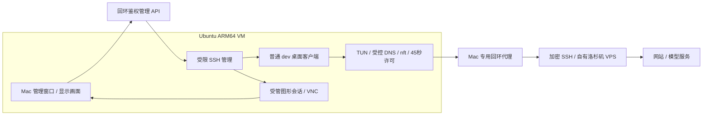

# Linux 沙箱桌面客户端技术方案

0.4.15 更新：显示与 Chrome 已拆分，旧方案下方按历史保留。当前设计与验证状态见 [桌面显示分离](desktop-display-separation-validation-2026-10-12.md)。

日期：2026-10-12。用户授权官方 Linux ARM64 Claude Desktop 和其他客户端的无账号测试；确认重置 / 删除才清除资料，普通关闭、重开及查看切换保留。项目路径 `/Users/staff/Documents/AIbox/AI/AIbeng/MuCodeSandbox`。

## 选择与范围

采用现有 Ubuntu 24.04 ARM64 VM，安装原厂客户端，不创建 macOS / Windows VM，不复制改造 Mac Claude.app，不修改浏览器内核。当前 4 CPU / 4GiB 足够作为首轮基本窗口测试配置；资源是否满足重任务须以后实际检验。

官方 Claude Linux beta 支持 Ubuntu 22.04+ / Debian 12+ 的 x64 / ARM64。[官方文档](https://code.claude.com/docs/en/desktop-linux)。Grok Bot 的官方“More downloads”提供 Linux ARM64 Debian 包，实际下载官方 0.68.1（99.3MB），安装后额外约367MB。[官方入口](https://x.ai/bot)。Claude 固定 2.31226.1 ARM64（174.1MB），包和官方仓库公钥指纹已核对。

本轮实现普通桌面客户端的安装、打开、关闭、资料保存及整环境重建。账号登录、付费任务、Cowork、电脑控制、语音、Grok 云电脑和全天稳定性不由这一轮启动检查代表。

## 架构与网络边界

- 安装 / 启动前和后调用原 `assertAccess`，验证防火墙、路由、DNS、批准出口和有效许可。业务普通 TCP 无需应用自行支持代理，仍通过客体透明路由；UDP / IPv6 拒绝。
- 固定允许 `grok-bot` / `claude-desktop`，没有任意可执行文件、下载 URL、命令参数或 Shell 的 API。官方包下载限速2MiB/s，验证长度 / SHA256 / 软件名 / 版本 / ARM64 后才做 root 安装；Claude 公钥指纹为 `31DDDE24DDFAB679F42D7BD2BAA929FF1A7ECACE`。
- 普通 dev 执行桌面程序，管理 / 安装权限不交给客户端。renderer 检查 UID、有效能力、seccomp、NoNewPrivs，不添加 `--no-sandbox`、忽略证书或伪造 OS。
- 受管 systemd unit 使用 `KillMode=control-group`，绑定显示会话；正常关闭杀掉客户端进程，不删除资料。监测失败沿用整环境隔离停机，内核许可到期关闭联网。
- Mac 的其他应用不在这一保护范围；Mac 不变更全局代理、时区或用户名字。默认没有 Mac 文件 / Shell / 剪贴板 / 摄像头 / 麦克风授权。

## 显示会话的当前取舍

复用现有 Chrome 图形会话和已鉴权 VNC / 音频通道，避免又安装完整桌面系统。Desktop 页以内嵌画面显示应用，桌面保持1600×1000 / 2×、默认完整适合窗口。一次通过受管入口打开一个客户端，减少首轮4GiB内存压力。

这一选择使客户端与浏览器显示服务生命周期共用：关闭浏览器显示服务会关闭客户端；各应用保存的数据仍保留。这是明确的当前运行方式，不声称已有独立显示服务或完整多桌面窗口管理。后续若需要浏览器与 Desktop 完全独立启停，可拆分公共显示服务，不涉及重编译浏览器或新增完整操作系统。

## 资料与凭据

按客户端设置 `XDG_CONFIG_HOME` / `XDG_CACHE_HOME` / `XDG_DATA_HOME` 和 user-data：`/home/dev/.local/share/mucodesandbox/desktop-clients/<id>`。第三方程序或其命令行工具也可能写到 HOME 或其他客体目录，因此“清除全部资料”不靠单一目录列表。

GNOME 密钥环按官方正常方式安装，不强制空密码或 basic 明文存储。首次真正登录时可能需要在客体内设置 / 解锁密钥环。本轮不登录，所以不将安装密钥环说成真实账号登录持久化已验证。

同一 Linux 用户下的应用可互读该用户的文件；独立目录是资料组织，不是两个程序彼此不可访问的安全域。不同账户 / 客户项目需要完全独立 VM。

## 完整重建

`POST /api/environments/<id>/rebuild-clean` 要求确认 `erase-entire-environment`：先关闭 / 撤销旧环境，删旧整盘及本应用的 snapshots / imports / browsers / disk-recovery / restore 副本，清除关联网络观察，再发布新 ID 的空白环境。旧清理失败不发布可用替代环境。

保留所选线路、地区与资源配置；新 VM 不携带旧共享、桥接、端口、客户端或快照。重建后需重新安装桌面客户端。普通关闭、重开和查看切换不执行此操作。

用户自行另存的导出备份、本机共享源文件、网站后台记录和 Grok 云电脑不属于本地环境删除范围。重建不会更换固定 IP，也不是 SSD 法证擦除或无法关联的承诺。

## 实现位置与验收

- 契约 / 白名单：`shared/guest-desktop.ts`。
- 固定安装配方、启动 unit、进程检查：`server/guest-desktop.ts`。
- 防护与完整重建：`server/manager.ts` / `server/service.ts` / `server/runtime.ts`。
- 桌面管理与重建确认：`src/DesktopPanel.tsx` / `src/panels.tsx` / `src/App.tsx`。
- 验证：`tests/guest-desktop.test.ts`、`scripts/verify-managed-desktop-ui.ts`、`scripts/verify-managed-desktop.ts`、`scripts/verify-clean-rebuild.ts`。

必须区分单元 / UI 夹具、真实 VM 进程和网络、真实本机窗口、真实账号四个范围。Mac 锁屏时不将未查看的真实窗口写成检查通过。原失败、修复和再验记录保存，不用成功结果覆盖未解释的错误。
