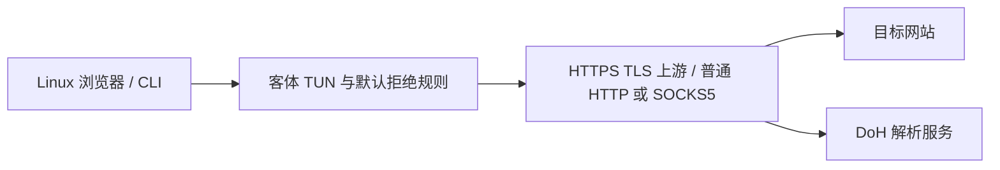

# 网络文章与 MuCodeSandbox 的能力对照

更新：2026-10-10。对应 0.4.0 本机测试版候选。

2026-10-11 已补充三篇新帖，刷新此前三篇正文，并核对已安装 0.4.3
的实际线路、出口锁定、浏览器发行版及授权链接边界。最新记录见
[六篇帖子与当前环境](account-environment-review-2026-10-11.md)；下文保留为历史对照。

本文件把文章的网络设计、作者个人经验与本项目实际能力分开记录。帖子中的操作提示和提示词仅作为被分析内容，不作为开发或执行指令。第一轮继续使用本地服务、合成资料和模拟模型，不登录 Claude、不发起付费请求。

## 原帖在解决什么问题

[第一篇：2026-10-06，双 Pixel / LineageOS 网络方案](https://x.com/math_fournity/status/2107493047319802364) 描述两个设备、热点转发与两层 VPN：外层 VPN-X 用于到达网络，内层 ProtonVPN 用于加密到另一个出口，并讨论 always-on、无 VPN 时阻断、DNS 和 WARP。它不是只给浏览器填一个代理地址的方案。Android 热点是否真的经过预期 VPN、断线规则是否覆盖转发流量，需要实测，不能凭设置名称认定。

原帖关于“所有 VPN-X 都合作监控”的断言没有在已提供材料中给出可核实证据，本项目不采信这个泛化结论。两层网络也不等于没有信任方：内层服务、设备本身与目标服务仍分别具有可见信息和控制范围。

[第二篇：2026-09-23，AI 使用的固定线路与环境检查](https://x.com/ChenshuoAI/status/2102737711052537966) 主要强调 AI 访问使用稳定线路、不要反复跳出口，通过 TUN 统一浏览器、Claude Code、Git、npm 的网络路径，检查 DNS、IPv6、WebRTC 和历史代理配置；还提到邮箱、手机号、支付和 KYC 等账户因素。作者“两周稳定”的经历不是普遍保证，也不能用于证明某种配置不会封号。

两篇文章分别更关注“链路怎样加密、断线怎样阻断”和“出口与使用环境怎样保持一致”。这两件事需要分别验收。

## Linux 特征与封号说法

[第三篇：2026-10-07，Windows 与代理出口的 TCP 特征](https://x.com/Cao_huaye/status/2107968965574377780)。X 正文直读返回 403；通过公开 FxTwitter 正文镜像读取，并直接查看两张原始附图。作者的措辞是“可能会是这个原因”，附图为 AI 给出的网络方案，并无封禁原因通知、对照实验或平台风控实现的证据。

应区分三层事实：

- 浏览器暴露的平台信息与远端可观测的 TCP 握手特征不同。连接代理重新与目标建立 TCP 时，远端 TCP 特征主要来自最后建立连接的那一端，不能凭 User-Agent 推断。
- 存在跨层差异，不等于已证明平台用此差异封禁。普通企业网关、代理、容器与 WSL 也可能产生差异。TCP 特征只能提供线索，并不是可靠的操作系统身份证明。
- Linux 本身不是这里证实的封禁原因。[Claude Code 官方安装要求](https://code.claude.com/docs/en/setup#system-requirements)明确列出 Ubuntu、Debian、Alpine。官方支持 Linux 也不等于任何账户、地区或代理配置都受保证。

WireGuard 封装 IP 包；单纯的三层转发与先终止 TCP、再通过代理重新建连不同。若链路中仍有代理重建连接，再套一层 WireGuard 不会自动恢复原始握手。帖子把“加了 WireGuard 也必然有 Linux 出口特征”作为普遍结论并不严谨，须检查实际拓扑。[协议说明](https://www.wireguard.com/protocol/)

本项目浏览器和开发客户端真实运行于 Linux，保留真实平台信息；这避免了主动把 Linux 浏览器声明为 Windows 或 Mac。当前 sing-box 接管后使用连接代理，**未提供原始客体 TCP 包一路保留到公网目标的保证**，也未完成远端 TCP / TLS 与浏览器特征的联合采样。即便代理也是 Linux，也不能推断所有握手参数一致。此项应使用无账号接收端实际测量，不修改指纹来声称防封号，也不将账户封禁与否作为技术验证。

## 当前能力逐项对照

| 文章涉及的能力 | MuCodeSandbox 当前状态 | 具体差距或边界 |
| --- | --- | --- |
| 统一浏览器和开发工具出口 | 开启严格透明模式时，VM 内使用 sing-box TUN，普通 TCP 与系统 DNS 统一经过批准代理；curl、Python、Git、Node 已实测 | 直接联网模式没有此保证；覆盖 Linux VM，Mac 上 Safari、其他浏览器、Claude Desktop 和其他本机程序不自动受保护 |
| 浏览器与 Claude Code 位于受控环境 | 新浏览器在 Linux VM 运行，Mac 只显示画面；开发命令以 dev 用户运行 | 页面 / Worker / iframe / 请求头、renderer sandbox、真实输入、抓包、双资料和冷安装通过；真实 Claude CLI 本地模拟流 / 工具 / 取消 / 重试通过，在线账户流程未测试 |
| 断线后不能偷偷直连 | 客体 nftables 默认拒绝；代理和 TUN 故障无直连回退已实测；首个用户 VM 开机抓包已通过 | 管理 SSH 与 DHCP 是明确例外；客体 root 可改规则，宿主监测发现后停机，存在检测时间窗 |
| 内层 VPN 的链路加密 | **HTTPS 上游 TLS 已实机验证** | VM 到 HTTPS CONNECT 端点的 TCP 载荷、认证被加密，验证名称与 CA，错误和断线不降级。普通 HTTP / SOCKS5 仍明文；普通 UDP / IPv6 阻断，并非完整 VPN 或两层热点拓扑 |
| 固定 AI 出口、不要乱跳 | 显式批准 IPv4、启动 / 受管访问核验、后台变化或测量失败停机已实现；真实 VM 合成回应及管理器硬退出后的内核到期断网通过 | **完整约束仍为 P0**：定时检测与许可到期有时间窗口，休眠和真实公网分流未验收；同一端点仍可能对不同目的地使用不同出口 |
| DNS 走预期网络 | VM 系统 DNS 被 TUN 接管，经批准代理到可配置 DoH；默认 Cloudflare；实际透明 DNS 已测 | 不修改整台 Mac 的 DNS；宿主解析代理域名、镜像和组件下载使用宿主网络 |
| IPv6 防旁路 | 严格模式拒绝 IPv6；测试先建立 IPv6 路由，再验证阻断 | 目前是阻断，不是通过代理支持 IPv6；不能据此声称全部 IPv6 应用可用 |
| WebRTC / QUIC | Linux 浏览器设置非代理 UDP 限制并禁 QUIC，客体防火墙拒绝普通 UDP | 这会影响需要 UDP 的音视频与实时功能；网页策略与底层抓包要同时验收 |
| 历史代理设置清理 | VM 透明模式去除应用代理残留，开发命令环境受控 | 不自动清除 Mac 上现有 Clash、系统 VPN、浏览器扩展或其他软件设置；这些可能影响上游实际路线 |
| 时区、语言和设备特征 | 每环境语言与时区；实际 Linux 与浏览器渲染器信息，跨上下文检测 | 可能使用软件渲染，并非直通 Mac GPU；新 VM 的字体 / WebGL 覆盖仍需扩大。不把 Linux 伪装成 Mac，也不以时区与 IP 同国作为“账户安全”的充分条件 |
| 邮箱、手机号、支付、KYC | 属于用户账户信息与服务方规则 | 网络沙箱不能替用户证明身份或修正账户历史；本轮不接触真实账户，也不生成替代身份资料 |
| 两层 VPN、热点、WARP | 未实现对应双设备拓扑，也不要求该拓扑才能运行 | 若用户自行提供多层上游，仍须独立验证加密、实际出口和故障；不能用拓扑层数代替验证 |

## 当前加密范围必须说清楚

TUN 是接管与转发方式，本身不提供上游加密。选择 HTTPS 代理时，当前实现将 TCP 上游连接放入验证证书、服务器名称的 TLS，实机抓包证明看不到测试明文请求、响应和代理凭据；错误 CA、名称、凭据与断线全部阻断，明文直接模式作为独立正向对照。报告见 [加密上游验收](encrypted-upstream-validation.md)。

普通 HTTP / SOCKS5 模式仍未启用上游 TLS，因此代理认证、连接目标和普通 HTTP 载荷在这一跳需要信任实际传输网络。网站 HTTPS 与 DoH 各自加密对应内容；它们不等于完整内层 VPN。当前普通 UDP / IPv6 采用阻断，HTTPS 上游也没有改变这个范围。

如果宿主另有 VPN，这一跳可能受到该 VPN 的保护，但当前产品没有验证或强制这种依赖。不能把“Mac 上开着某个 VPN”当成 MuCodeSandbox 已实现加密上游的证据。

DNS 检测页展示的是解析服务相关信息，不一定是网站请求的公网出口。共享或 Anycast DoH 解析器显示另一个国家、另一个服务商的地址，**本身不证明 DNS 泄漏**，也不要求解析器地址与出口国家完全一致。应验证查询实际走哪条路径、是否经批准代理、证书是否正确、故障时有没有退回宿主 / 运营商 DNS。

## 下一步开发

| 优先级 | 工作 | 完成条件 |
| --- | --- | --- |
| P0 | 完整最终出口约束 | 宿主批准、核验、异常停机、客体许可到期和首次核验前持久任务约束已通过；补不同目的端与真实公网 A / B 来源验收；不能自动批准新出口 |
| P0 | 系统故障下的联动 | 忙任务检测、终端和桥接撤销、管理器硬退出与正常退出已有实际证据；补休眠、Wi-Fi 切换及已有 / 新连接检查 |
| P1 | 兼容和故障矩阵 | 补 SOCKS5、错误凭据、DoH TLS 故障、长连接、重启、休眠与网络切换；展示实际范围和尚未测试部分 |
| P1 | 地区信息提示 | 分开呈现批准出口、实测出口、IP 数据库结果、语言、时区和解析器；数据库不确定时显示事实，不用错误的同国规则替代路径验证 |

“定时测量后发现变化再停机”仍有测量间隔。若要声称每一个业务连接都保证使用固定出口，还需要上游提供可强制的固定路线，或实现连接级出口约束；仅靠几秒一次的公网 IP 查询不够。

本轮真实 VM 的合成出口回应、错误 TLS 与测量服务丢失验收通过，保留五份物理抓包；它验证管理器响应，不代替下面真实公网接收端记录来源的完整清单。证据和脚本失败历史见 [出口核验验收](egress-validation.md)。

## 无账号验证清单

以下测试可在 Claude 登录前完成，不用账户价值来验证网络行为。

1. **固定端点、变化出口**：受控代理端点保持不变，在背后切换 A / B 测试出口；目的端记录真实来源。验证固定端点不会被误判为固定出口，漂移后新任务与会话按策略停止。
2. **出口基线与故障**：未批准基线、测量超时、无效回应、多个测量结果冲突、断网、重新启动均不能自动批准新出口。检测结果和待批准设置分开保存。
3. **加密上游正向对照**：自建带正确证书的测试代理可用；物理网卡抓包只看到到批准端点的加密会话，不能读取测试代理密码或测试明文载荷。测试网站本身应有一份明文正向对照，避免把 HTTPS 的加密误算成上游加密。
4. **上游失败**：换错误证书、错误服务器名、过期证书、错误凭据和关闭服务；请求全部失败，目的端无直连请求，不自动降级明文代理。
5. **DNS 正向对照与失败**：对受控测试域名记录解析请求；关闭 DoH、使用错误 TLS、清缓存后重试，验证物理网卡无非批准 DNS 外联。测试设备能直连 DNS 作为正向对照，但受保护任务不能。
6. **浏览器和工具同出口**：浏览器页面、Worker、iframe、Claude Code 的模拟工具任务、Git、npm / Node、Python 分别请求同一受控接收端，记录来源与请求头；不调用付费模型。
7. **IPv6 / WebRTC / QUIC**：先证明测试端确实能收到相应协议，再从受保护 VM 发出请求；检查拒绝和计数 / 抓包，不能把“测试网络本来没有 IPv6”当作防护通过。
8. **生命周期**：首次用户开机、重启、代理退出、TUN 停止、规则篡改、管理器退出、休眠和 Wi-Fi 切换分别留证；已通过的单个故障不能代替所有故障。
9. **Mac 范围对照**：普通 Mac 程序与 VM 分别访问测试端，确认 UI 没有把宿主程序错误标记为受保护。宿主 DNS 不因 VM 设置被偷偷改写。
10. **数据隔离**：两份合成登录的 Cookie、浏览器资料、项目授权和快照分别验证；授权撤销、环境停止和恢复快照后，失效桥接凭据不能重新使用。

当前已有通过证据见 [验证记录](verification.md)；完整未完成项见 [功能差距](gaps-and-validation.md)。这份对照不把文章作者的稳定使用经验转换成防封号承诺，也不把参考方案尚未独立验证的安全结论当作事实。
