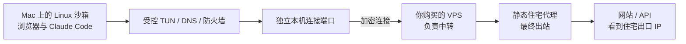

# VPS + 静态住宅出口：搭建与验收方案

日期：2026-10-11。本文最初记录 VPS / 住宅均未购买时的链路计划。
2026-10-13最新决定：**用户只需要现有VPS，取消静态住宅购买与VPS→住宅链路。** 本文住宅相关步骤及未勾选事项保留为历史方案，不再执行，不是当前待办。已采用DediOne VPS的SSH SOCKS5直接出口；实际服务器与连接路径见[DediOne接入](vps-dedione-setup-2026-10-11.md)，最新停机 / 候选状态见[项目状态](project-status.md)。
项目：`/Users/staff/Documents/AIbox/AI/AIbeng/MuCodeSandbox`。

## 先理解三段线路



VPS 是远程服务器，住宅线路是最后访问网站的出口。两者需要在配置中
串起来。只买 VPS、只将其节点导入客户端，网站看到的通常仍是 VPS 出口。
一个“静态住宅 IP”产品可能是提供商的代理服务，不是你拥有并能 SSH 登录的家用电脑。
代理连接地址 / 端口与最终出站 IP 可能不同，不能混填。

## 原帖核对

[原帖](https://x.com/newbeeyu/status/2104763468360642916) 关联
[文章](https://x.com/i/article/2064281284944519168)：美国 VPS、Ubuntu、Xray /
VLESS Reality、Clash Verge，属于 VPS 节点教程。插图为示意图，没有完整
安装脚本 / 服务端配置 / 实测速率；其“国内直连”分流不能直接套入本项目
沙箱全部使用指定出口的目标。它没有提供 VPS → 静态住宅代理的完整配置。

文章中的客户端 / 服务端应单独核对版本。[Mihomo 官方 Reality 配置页](https://wiki.metacubex.one/config/proxies/tls/#reality-opts)
对较新 Xray 的兼容性有明确说明，不能把“装两边最新版”当成已测试。
本文先采用普通加密连接接入，若本地到 VPS 的网络需要其他协议，再按实测选择。

## 购买 / 准备清单

| 内容 | 要拿到什么 | 核对条件 |
| --- | --- | --- |
| VPS | 地区、系统、地址、SSH 端口与管理员连接方式 | 到你所在地及住宅网关稳定；允许你部署转发服务；本方案不需要公网开放代理端口 |
| 住宅线路 | 美国地区、连接地址、端口、协议、认证方式、固定出口说明 | 静态与独享分别确认；租期 / 更换政策；可由这台 VPS 连接；支持 HTTPS CONNECT 或 SOCKS5、长连接与足够并发 |
| 加密能力 | 住宅代理是否提供 HTTPS/TLS 或专属加密隧道 | SOCKS5 本身不加密认证信息；网站 HTTPS 加密内容与代理连接加密是两回事 |
| 用量 | 配额、超额规则、是否计双向流量、限速和空闲断开 | 浏览器、CLI 流式输出、下载都需要；先短期验证，不按宣传词认定适合 |

VPS 地区可优先接近住宅出口，以减少中转延迟；美国 VPS 本身并不会让
最终住宅 IP 变得更“住宅”。供应商的固定 / 独享声明和实际测量分别保存。
密码、私钥和完整带认证 URL 只放在应用或服务器的私有配置中，不写进 MD、聊天或日志。

## 第一阶段：简明接入

MuCodeSandbox 自带客体 TUN、受控 DNS 与严格防火墙，负责沙箱内程序的
路由。它支持 HTTP / HTTPS / SOCKS5 / WireGuard 上游；不负责整个 Mac
的域名分流，也未提供直接导入 VLESS Reality 订阅的入口。现有越南 / 美国
节点测试使用电脑已有的 Clash/Mihomo 内核作为上游，这层不是本软件自行实现。
采用下面的 SSH + VPS HTTP 入口时，不需要全局 Clash 分流；若沿用原帖
的 VLESS Reality 节点，当前仍需兼容的接入组件把它转换为本机代理端口。

推荐先做一个专用连接，Mac 原有 Clash 全局配置和其他环境保持独立。

1. VPS 安装经过来源核验的 sing-box，建立专用服务用户；不要在 VPS 上放 Claude 账号。
2. 在 VPS 上建立只监听 `127.0.0.1:18080` 的 HTTP 转发入口。
3. 该入口的唯一业务出站是住宅代理；DNS 经该住宅线路发往受控 DoH。
   不配置 `direct` / “住宅失败就用 VPS”备用出口。住宅密码保存在受限配置文件。
4. Mac 用 SSH 建立到 VPS 的加密连接，把 VPS 本地入口映射到 Mac 的 `127.0.0.1:24898`。
   SSH 密钥认证，核对首次服务器指纹；保留现有系统端口和防火墙设置。
5. 新建独立的 MuCodeSandbox 环境，选择这个本机 HTTP 端口，开启严格防火墙和透明代理。
6. 先用无账号网页 / CLI 验证实际住宅出口；确认后填写出口 IP 锁定和预期美国时区。
   这里的锁定填写**测得的最终住宅 IP**，不是 VPS 地址或代理网关地址。

Mac 连接命令模板（先替换参数，当前未执行）：

```sh
ssh -N -T \
  -o ExitOnForwardFailure=yes \
  -o ServerAliveInterval=15 \
  -o ServerAliveCountMax=2 \
  -L 127.0.0.1:24898:127.0.0.1:18080 \
  -p SSH_PORT VPS_USER@VPS_ADDRESS
```

`24898` 是本机专用端口，需要先确认未占用。此端口不监听局域网。
SSH 连接断开即失去该入口，沙箱不得回退到本机直连。
若到 VPS 的 SSH 路径无法稳定使用，再考虑 HTTPS / VLESS 等接入；
这只改变“Mac 到 VPS”这一段，VPS 的最终业务出站仍应固定为住宅线路。

[OpenSSH 官方端口转发说明](https://man.openbsd.org/ssh#L)
· [sing-box HTTP 入口](https://sing-box.sagernet.org/configuration/inbound/http/)
· [SOCKS 出站](https://sing-box.sagernet.org/configuration/outbound/socks/)
· [HTTP / HTTPS 出站](https://sing-box.sagernet.org/configuration/outbound/http/)

## MuCodeSandbox 填写对照

| 应用字段 | 推荐值 / 含义 |
| --- | --- |
| 环境 | 新建美国线路环境；正式 Chrome 使用空白资料，不降级读取现有测试版资料 |
| 类型 | HTTP（SSH 加密包裹本机到 VPS 的连接，不在应用中填写住宅密码） |
| 代理服务器 | `127.0.0.1` |
| 端口 | `24898`，确认 SSH 已准备并监听 |
| 严格防护 / 透明代理 | 都开启 |
| 外部直连例外 | 不添加 |
| 地区 / 时区 | 按实际预期美国地区设置，保持 en-US；不修改 Mac 时区 |
| 出口变化停机 | 锁定实际住宅 IPv4；变化或核验失败关闭访问 |
| CPU / 内存 | 先 4 核 / 4 GiB，结合实际宿主压力与并发任务再增加 |

本机已有越南专用线路不能被这个端口覆盖。当前美国 B1013 的成功功能
回执仅用于开发测试，不是本方案住宅线路已部署的证据。

## 分段验证，先不登录账号

| 阶段 | 检查 | 通过条件 |
| --- | --- | --- |
| 住宅本身 | VPS 通过住宅代理访问两个接收端 | 回执一致、国家正确；记录 ASN / 来源 / 固定性，不仅凭营销标签 |
| VPS 转发 | 经 VPS 本地入口访问同样接收端 | 仍是住宅出口；不是 VPS IP |
| Mac 连接 | 经本机专用端口重复访问 | 与 VPS 住宅回执一致；SSH 断开后请求失败 |
| 沙箱 | 浏览器、Worker相关请求、CLI在多个接收端比较 | 一致且符合出口锁定；检查时区 / 语言；配置无意外变化 |
| DNS / 连接 | 对照 DNS、代理日志、受控目的端回执与客体网卡抓包 | 客体没有外部直连；受控 DNS 经同上游。代理连接日志不是每条连接公网出口证明 |
| 故障 | 分别断住宅出站、VPS 转发和 Mac 专用连接 | 每一段失败都不得切 VPS IP / 本机 IP，沙箱拒绝访问 / 进入隔离状态 |
| 长连接 | 无账号合成流式 API、普通 HTTPS / WebSocket | 无意外空闲断开、足够稳定并发；先短测试，全天测试继续暂缓 |

出口锁定是周期检测与故障控制，有检测窗口；服务器上没有备用直连
出站才是避免住宅故障立即回退 VPS 的关键。IP 分类数据库只能提供
分类证据，不能证明租户独享或网站不会限制账号。这个方案改善网络
出口和稳定性，不改变 Linux / VM / 软件图形这些真实设备事实。

## 待办

- [ ] 用户补充已有资源状态、VPS 地区 / 系统及住宅协议（不含密码）。
- [ ] 确定客户端到 VPS、VPS 到住宅两段的加密 / 接入方式。
- [ ] 按真实协议生成服务器配置，校验后安装，服务账号及文件权限检查。
- [ ] 专用本机连接及沙箱接入，不覆盖越南端口或 Clash 全局配置。
- [ ] 完成上表分段、断线与长连接验收；保存版本、配置摘要与回执。
- [ ] 验收后选择是否进入真实使用；首轮继续无账号 / 不付费模型。
