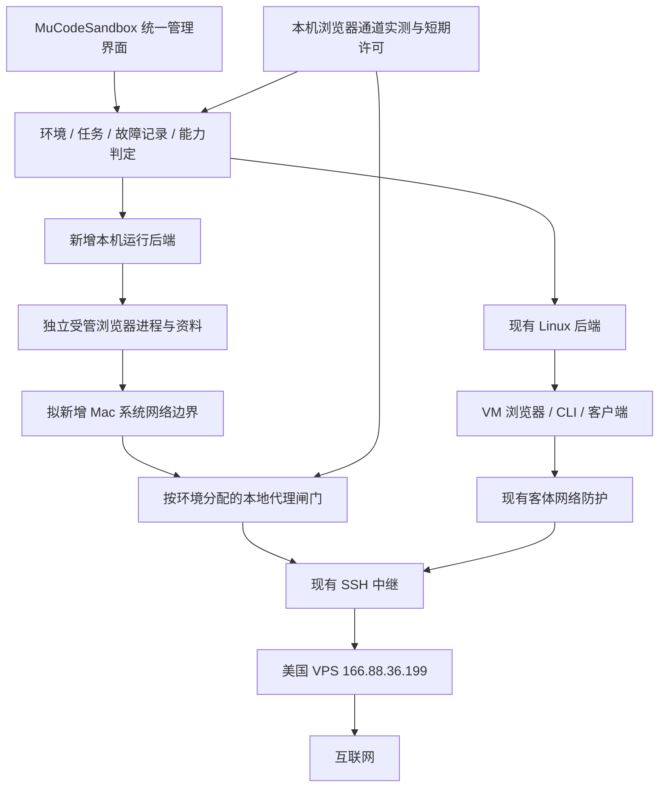

# 可选本机模式：完整方案与竞品参考

2026-10-13 最新决定：用户恢复 Linux 优化和本机模式，验收要求为最终可日常使用；不以离线演示替代交付。本机签名 / 系统防护条件尚未具备，原型试验未通过，停止扩大演示；优先交付 Linux 卡顿修复。以下“暂缓 / 暂不改代码”按历史时点理解，最新证据见[本轮进展](../linux-performance-2026-10-13.md)。

日期：2026-10-13。当前状态：**已获准推进，但严格本机模式尚未具备部署条件，未交付**。用户后来恢复 Linux 优化和本机模式，并明确要求最终可用；较早的“暂缓 / 只给方案”已被取代。Linux 0.4.25 已安装，用户反馈日常操作明显顺畅。本机离线原型试验失败，未接入日常入口；不继续扩展仅供演示的功能。参考 CCBaga 与 Code Sandbox 的核对记录继续保留。

项目：`/Users/staff/Documents/AIbox/AI/AIbeng/MuCodeSandbox`。当前已安装 Linux 基线为 0.4.25 / `9d9b626e19754aad`，见[性能与实机记录](../linux-performance-2026-10-13.md)。本机方案本身不代表可用版本。

17:05 后只读前置核对：macOS 26.3.1；当前钥匙串查询未找到可用代码签名身份；Karing 和另一安全软件网络扩展已激活。SDK 提供来源应用 / 建连进程 audit token，但常见的 `sourceAppIdentifier` 字段在 macOS 不可用。P0 需明确签名、共存与 helper 归属条件，见[实机前置记录](../native-mode-preflight-2026-10-13.md)。尚未启动原型或安装组件。

## 1. 建议结论与目标

在现有管理器里增加与 Linux VM 并列的 **本机模式**，优先交付受管浏览器，桌面客户端逐个适配。共用环境列表、VPS 线路、出口核验规则、延迟、事件记录和恢复入口；运行进程、资料、联网许可分别归属于各自环境。

- Linux 模式继续承担完整客体文件系统、CLI 和现有桌面客户端的隔离运行。
- 本机模式让浏览器直接在 Mac 上运行，优先改善图形、窗口、输入法、复制粘贴和文件选择体验。能否实际使用硬件加速，仍以渲染器和页面结果验证。
- 创建本机环境不需要另建 Linux 或 macOS 虚拟机；若其他 Linux 环境正在运行，它们继续独立管理。
- 本机使用真实 macOS / Apple Silicon 信息；不承诺隐藏设备、变成美国实体电脑或获得平台账号认可。出口继续使用现有美国 VPS `166.88.36.199`，不恢复住宅采购目标。
- 至少两处独立、新鲜、与批准 IP 一致的回执仍是联网门槛。故障要停止对应环境的联网、保存原因并给出恢复步骤。

**“独立”在本机阶段指资料和受管生命周期独立，不表示与 VM 相同的操作系统隔离。** 同一 macOS 用户下的原生应用仍受该用户已有文件权限约束，独立目录本身不能阻止其他同用户进程读取，也不能保证本机应用只能访问项目目录。需要这种强隔离的任务继续使用 Linux 模式。

## 2. 当前已经有什么

| 已有位置 | 核对结果 | 新方案处理 |
| --- | --- | --- |
| `shared/types.ts`、`src/forms.tsx` | 已有 `vm` / `browser` 类型与“本机浏览器”创建入口 | 扩展能力说明与后端归属，不重新造环境管理系统 |
| `desktop/main.cjs` | 本机网页使用 Electron `persist:mu-<id>`，独立会话、固定代理、权限默认拒绝 | 可以借用会话和窗口逻辑，但需分离受管运行进程与管理器 |
| `server/browser.ts` | 另有专用 `--user-data-dir` 的本机 Chrome 启动路径 | 保留为引擎候选；不能把命令行代理视为系统防漏 |
| `desktop/identity.cjs` | 按网页上下文设置时区、语言，检查实际结果 | 与 Mac 系统设置分开，明确浏览器作用范围 |
| `server/validation.ts`、`src/ProtectionBanner.tsx` | 明确不支持本机 Linux 防火墙；UI 提醒本机边界 | 新防护实测通过前继续显示未具备相应保护 |
| `server/egress.ts`、`shared/protection-events.ts` | 已有双回执、错误分类、异常 IP、恢复记录 | 复用判定与事件格式；测量实现按运行后端分别接入 |
| `server/host-network.ts`、`native/NetworkMonitor.swift` | Mac 网络状态和变化监测 | 可复用，但监测器不是逐进程防火墙 |
| `src/EnvironmentStatus.tsx`、`src/CleanupScope.tsx` | 已有配置 / 实测 / 有效期展示、清理范围 | 增加后端与真实能力，避免本机沿用 VM 的绿色标记 |

当前本机 `testNetwork` 使用宿主 curl，不是网页自身的网络栈；本机清理主要调用 Electron 清站点数据和缓存，不能据此声明完整环境删除已覆盖所有文件。现有 Linux 延迟、保护和客户端功能也不能直接复制“通过”状态给本机。

已有失败证据必须保留：2026-10-10 的 `sandbox-exec` 继承式策略使 Chrome / Electron 内部沙箱初始化失败，GPU / 网络进程无法正常启动。该路线未通过，不以关闭 Chromium sandbox 解决，也不把零流量当成成功。见[原始验证](../mac-browser-enforcement-validation.md)。

## 3. 两份参考具体借鉴什么

### CCBaga：有公开源码，可以逐文件审查

本轮源码基准：`liseami/CCBaga`，提交 `aff6122719c479effd4d53c7d875bcc3c04edcc8`。本地只读副本：`/tmp/ccbaga-review.N5Te0v`，临时目录可能被清理，以下固定提交链接用于长期定位。

| 参考实现 | 借鉴方式 | 本项目需要补的边界 |
| --- | --- | --- |
| [浏览器窄接口](https://github.com/liseami/CCBaga/blob/aff6122719c479effd4d53c7d875bcc3c04edcc8/src-tauri/src/browser/server.rs)：回环监听、随机会话令牌、输入大小限制、资源路径检查 | 浏览器检查页只交换有限配置和测量结果；会话停止后失效 | 加入来源校验、代次与超时；页面上报不能直接授予联网许可，网页不能获得文件 / Shell 控制权 |
| [网络结果](https://github.com/liseami/CCBaga/blob/aff6122719c479effd4d53c7d875bcc3c04edcc8/src-tauri/src/browser/network.rs)：配置与实际测量分别处理 | 读数失败或缺失明确展示，不用配置填充实际值 | 其服务顺序回退成功不等于我们的双独立回执；保留现有更严格规则，增加浏览器实际通道测量 |
| [资料管理](https://github.com/liseami/CCBaga/blob/aff6122719c479effd4d53c7d875bcc3c04edcc8/src-tauri/src/browser/profile.rs)：占用检测、链接检查、有限文件修改 | 先确认所属进程退出，再清理本环境拥有的资料 | 还要覆盖 Mac 外部落盘、凭据与异常中断；拒绝路径越界和误删个人资料 |
| [独立启动器](https://github.com/liseami/CCBaga/blob/aff6122719c479effd4d53c7d875bcc3c04edcc8/browser-runtime/launcher/CCBrowser.c) | 管理器和浏览器运行单元分离，始终使用独立资料 | 参数 / 管理服务缺失时保持拒绝业务联网，不能仅靠资料兜底后直接启动 |

其 [README](https://github.com/liseami/CCBaga) 也区分了 TUN 配置与实际验证，并明确 DNS / WebRTC 未独立验收。由此不能推导它已经提供我们要求的完整断网保护。其修改宿主系统地区、身份归档库和指纹轮换不纳入本方案。原项目代码为 MIT；如后续复用实现，应保留许可和版权，浏览器二进制另查自身条款。本轮未复制代码。

### Code Sandbox：产品与旧包证据可参考，不能当作完整源码

| 证据 | 借鉴方式 | 不能据此推定的结论 |
| --- | --- | --- |
| 旧包中的 Desktop profile namespace、execution environment binding、launch epoch、幂等操作 | 将“谁拥有资料”“进程在哪里运行”“这次启动属于谁”分别建模，避免开错窗口或串环境 | 不证明最新版所有客户端的实际资料隔离和清理行为 |
| 旧包中的 Mac 浏览器模块、sing-box、管理员辅助组件和 Linux nft | 采用统一界面、不同平台后端的组织方式；网络实现独立适配 | 有 TUN / 辅助组件不等于断线后绝不直连；未验证竞品完整故障覆盖 |
| 用户 beta.16 截图中的升级保留恢复副本、清缓存与清站点数据分开 | 升级与重置是不同事务；动作前准确说明保留和删除范围 | 本项目的“全新环境”不能默认保留旧登录，不能用刷新指纹替代清资料 |
| [使用说明](https://code-sandbox.cc/guide/precautions/)区分 Desktop Local 与 SSH 任务位置 | 后续混合工作流明确显示应用位置与任务执行位置 | 不能因 UI 在 Mac 就断言任务在 Mac，也不能因任务在 VM 就把 Mac 客户端算作 VM 隔离 |

旧包实证见[拆包复核](../competitor-desktop-review-2026-10-12.md)。本轮重新读取[下载页](https://code-sandbox.cc/download/)仍为 beta.15，用户截图为 beta.16；没有下载或动态验证 beta.16。闭源实现只借鉴可观察设计，不把符号、宣传或截图当成完整安全证明。

## 4. 推荐架构

图中的 Mac 系统网络边界和本机许可通道均为待实现项。

### 4.1 共用管理能力，分别落实执行与防护

建议在现有 manager 上逐步增加后端适配层，避免先做大规模重构：

- 环境记录声明运行后端、拥有的资料根、支持的应用、保护级别和绑定线路。
- 后端负责启动、关闭、读取、停止联网、重置、删除和恢复检查。
- 防护结果包含后端、环境 ID、启动代次、规则版本、回执时间和有效期。VM 的回执或上一次进程的成功不能批准本机的新进程。
- UI 依据实际能力显示操作。Linux 系统快照不套给本机，本机备份也不写成完整系统快照。
- 新环境创建时选择模式；已有环境不提供原地一键变成另一种模式，以免误以为资料已完整迁移或销毁。需要另一模式时创建全新环境。

### 4.2 引擎与进程组织

优先评估正式 Mac Chrome 的独立实例：标准浏览器兼容性和原生图形较好，指定全新资料，不读取用户日常 Chrome 资料。需要独立核对版本、签名、进程树、网络 helper、已有个人 Chrome 同时运行及升级行为。

这里有一个必须先解的技术问题：**相同 Chrome 应用的不同 profile 可能使用相同签名 / bundle 标识，过滤规则不能仅按应用名称判断。** 需要核验进程身份、启动代次与真实网络流的归属，并覆盖新生 helper；不能因为限制了主进程就宣称全部受控。

若正式 Chrome 无法可靠区分受管实例与个人实例，再评估有独立应用身份的受管 Electron 浏览器运行单元。可复用现有窗口与会话实现，但要与管理器网络进程分开；产品如实标明 Electron / Chromium，不称作 Google 正式 Chrome。网页仍保持 context isolation、renderer sandbox 和 Node 禁用。

**引擎选择在第一阶段实证后定案。** 不编译 Chromium、不更换指纹内核，不通过关闭引擎沙箱或重写真实 GPU / OS 标识换取运行成功。

### 4.3 Mac 网络防护是先决项

首选研究 Apple Network Extension 的系统扩展，用可核验进程身份限制受管浏览器的连接。Apple 提供允许 / 拒绝连接的机制，但它不自动解决应用归属、许可过期和扩展故障；这些必须实现并实测。

计划采用两层：

1. 系统网络边界让受管浏览器只连接自己的受限本地代理，限制直接 TCP、UDP / QUIC / WebRTC、IPv6、局域网与其他回环服务。浏览器解析经受控通道；若系统代办 DNS 或 helper 无法正确归属，记为缺口，不发布为严格模式。
2. 每个环境有独立代理闸门和连接集合，经现有 SSH 中继走批准 VPS。闸门按有效许可放行业务；许可撤销要关闭已建立连接，不能只拒绝新连接。共用 VPS 或中继不共用环境许可。

Mac 内容过滤系统扩展涉及正式签名、相应 entitlement、安装激活和用户在系统界面的授权。现有 adhoc 本机包不能视为已满足发布条件。开发者签名资源与当前 macOS 支持情况需要在可行性阶段确认，不在本轮安装或要求用户认证。

如果这条路线无法在合理工作量内提供必要的进程归属与故障行为，本机严格模式保留未就绪，Linux 继续可用。代理设置成功或 TUN 已打开不能替代该验收；也不静默改用全 Mac 全局接管。

参考：[Apple 网络过滤](https://developer.apple.com/documentation/networkextension/filtering-network-traffic)、[系统扩展部署条件](https://developer.apple.com/documentation/technotes/tn3134-network-extension-provider-deployment)。

### 4.4 出口核验与故障处理

启动顺序：

1. 加载本环境拥有的资料与已批准线路，检查是否需要清理恢复。
2. 安装有效拒绝规则并确认网络保护组件可用。
3. 准备专用代理闸门和中继；核验阶段只允许固定检测服务，不开放其他业务访问。
4. 启动空白本地检查页面，通过浏览器实际网络上下文取得至少两份独立一致回执。HTTP 缓存、旧会话报告、网页自行提交的 JSON 均不能直接作为授权凭证。
5. 回执与批准 IP 一致、进程归属及规则检查通过后，签发有期限许可，才加载业务页。继续周期核验。

Electron 候选可使用对应 `session.fetch` 并核对实际页面 / Worker；正式 Chrome 候选需要在该受管实例内执行受控测量。宿主 curl 只做诊断，不替代浏览器结果。[Electron 会话文档](https://www.electronjs.org/docs/latest/api/session#sesfetchinput-init)说明其请求使用该会话的 Chromium 网络栈。

沿用现有双回执与错误分类：不足两份关闭；返回异常 IP 立即拒绝；两个成功也不能掩盖另一个明确不一致结果。只有现有规则明确允许的第三端超时才可能由另外两份合格回执覆盖，不借接入本机放宽门槛。

网络变化、核验失败、规则异常或许可过期时撤销许可、关闭对应代理连接并停止对应受管进程。Mac 本身不关机，个人浏览器和无关环境不一起停止。网络恢复不自动切成直连，也不自动批准新 IP。

新增故障记录覆盖：保护组件不可用、helper 归属未知、中继失败、DNS / TLS / 认证错误、回执不足、IP 不一致、旧连接未关闭、清理中断。保存发生时间、环境与代次、批准 / 实测 IP、失败阶段、阻断结果与下一步。恢复走“检查 → 重新核验 → 手动启动”，历史故障原件与恢复结果分别保留，敏感凭据不入日志。

许可必须有独立截止时间与崩溃处理。UI、服务、闸门、系统扩展分别崩溃或失联的行为都要做短时测试；如果保护组件消失后会恢复直连，不能把“通常能检测到并退出”写成“失效即断网”。此项决定严格本机模式能否交付。

## 5. 资料、地区、权限与日常体验

### 5.1 每个环境拥有自己的资料

拟议目录在应用数据根下使用 `native/<environment-id>/`，包含浏览器 profile、客户端专用配置、受管缓存、临时文件、内部恢复材料和下载目录；最终目录迁移需与现有 Electron partition 对照。凭据不放在命令行或公开日志，文件权限限制为当前用户。

同环境关闭重开保留 Cookie、站点存储、书签和客户端资料。新建环境为空白，不复制个人 Chrome、旧 VM 或其他环境的资料。切换查看不触发清理。第一版建议同时只运行一个受管本机环境，先解决进程与深链归属，再考虑多个本机实例并发；可与已有 Linux 环境并存。

完整重置 / 删除按可恢复的清理事务处理：关闭网络 → 退出所属进程 → 核对占用与路径 → 删除拥有的资料及恢复副本 → 清理已识别的外部落盘 → 复查 → 标记完成。中途失败保留“清理未完成”，阻止复用半清空资料，不自动把旧登录恢复到新环境。

正式接入桌面客户端前必须列出它的真实写入位置，包括 `~/Library/Application Support`、Caches、Preferences、Saved Application State、临时目录、Keychain 项、协议处理器与自动启动项。`HOME`、`XDG` 或 `--user-data-dir` 不是覆盖所有 Mac 原生 API 的证明。

每一项必须能确认归属；无法与个人客户端区分的 Keychain / 全局资料不自动接管或删除。此时该客户端不提供“独立本机安装”入口，继续可用 Linux 版。用户不需要额外身份保险库，因此不增加账号归档 / 自动共享登录。

“清理完成”限定为本应用拥有且已核对的本地资料。用户另存到外部位置的文件、系统备份、云端记录和 SSD 物理擦除不在逻辑删除证明内；确认界面列出清除 / 保留范围。

### 5.2 地区设置与设备能力

- 浏览器环境可配置 `en-US` / `America/Los_Angeles`，只作用于受管浏览器上下文，并测量主页面、iframe、Worker 与相关请求头；不改变整个 Mac 的语言、地区或时区。
- Mac 原生客户端可能使用系统区域服务而忽略进程变量，必须逐应用核验。无法局部设置时明确显示“跟随 Mac”，不假称与网页设置一致，也不静默改全局系统设置。
- 本机屏幕、DPR、GPU、音频、字体、操作系统保持真实值。按真实窗口布局，不走 VNC 缩放；检查窗口 / 全屏、文字清晰度、Metal / ANGLE 实际后端及软件回退。
- 文件选择由用户明确选取，默认下载到本环境目录；复制粘贴按用户动作处理，不后台同步全部剪贴板。选择或另存到 Mac 外部位置会扩大数据保留范围，UI 清楚展示。
- 摄像头、麦克风、位置、屏幕录制和辅助功能分别按需授权；浏览器沙箱与系统权限继续保留。桌面客户端的实际权限不能沿用网页权限结论。
- OAuth、新窗口和协议深链回到启动它的环境；默认不把业务登录自动丢给个人浏览器。未实现安全归属的协议先阻止并显示原因。

### 5.3 界面建议

新建时两个选项：**Linux 隔离模式**与**本机模式**，简明显示各自作用范围。本机页保留总览 / 浏览器 / 网络 / 日志 / 设置；客户端入口只显示已适配项目，不堆放无法使用的按钮。

标题附近统一显示模式、出口 IP、线路延迟；保护卡分别显示“系统网络保护”“出口回执”“资料范围”。检查中的进度放在实际浏览器区域，未就绪时给缺失组件或失败原因。当前仍属旧本机浏览器功能的环境显示真实能力，不自动升级为已保护状态。

## 6. 分阶段实施与完成条件

| 阶段 | 工作 | 完成条件 / 停止条件 |
| --- | --- | --- |
| P0 可行性验证 | 确认系统扩展签名资源；空白浏览器、真实 helper 归属、GPU 与代理故障短测 | 能正常浏览且不影响个人 Chrome；强制绕过代理 / helper 新生 / 保护失联有明确阻断证据。无法达成则停止严格模式交付，不先堆 UI |
| P1 基础接入 | 后端适配、独立运行单元、专用资料根、生命周期与能力说明 | 新环境启动 / 关闭可追踪；个人和 VM 资料不迁移；不会误开旧窗口或误关个人进程 |
| P2 网络与证据 | 系统边界、按环境代理闸门、浏览器实际双回执、许可和错误恢复 | 正常批准出口；缺回执 / 异常 IP / 中继中断关闭；已建连接终止；故障原件保留、手动恢复可用 |
| P3 日常体验 | 网页、地区实测、图形、全屏、文本 / 文件操作、下载和登录跳转归属 | 无账号合成场景通过；同环境重开保留；新环境不继承；相关显示与权限无回归 |
| P4 清理与更新 | 完整资料清理、失败恢复、引擎版本 / profile 兼容、升级回滚 | 清理后受管目录及已识别外部项无残留；升级不清登录、不让旧引擎打开新资料；中断不误报成功 |
| P5 客户端适配 | Claude Desktop 等逐个审计参数、进程、数据、凭据、权限与深链 | 只有网络归属和清理范围都能落实的客户端开放；仅测试未登录基本启动与退出，不恢复已取消高级功能 |
| P6 后续扩展 | 按实际需要增加本机 CLI 或明确的 Mac UI + Linux 执行混合模式 | 本机原生命令的文件访问和子进程范围单独成立；不能用浏览器测试替代；当前不自动进入实施 |

P0 是主要不确定性与工作量分界：本机显示和资料入口已有基础，系统级网络保护尚未完成。先做有上限的验证，再决定是否值得继续，不先承诺几天完成全部 Mac 防护。

## 7. 短时验收清单

不做全天验证、不购买住宅、不登录真实账号。每项用一次可复现的合成场景及必要回归；失败根据证据修复，不反复盲测。

| 检查 | 要保留的证据 |
| --- | --- |
| 正常启动与图形 | 实际引擎 / 平台 / 图形后端、窗口完整性；不能只看参数 |
| 双回执 | 两个以上独立服务经该浏览器通道返回批准 IP；缺失和异常 IP 场景均拒绝 |
| 网络边界 | 直接 TCP、DNS、UDP / WebRTC、IPv6、局域网和其他回环端点；按归属独立抓取 / 接收端观测，不能只靠配置读数 |
| 故障与连接存续 | 中继断开、页面 / Worker 旧长连接、管理器和保护组件退出、许可过期；没有直连回退，结果准确记录 |
| 个人浏览器并行 | 日常 Chrome 正常运行且资料 / 路线未误改；受管 helper 不因同名进程逃出规则 |
| 资料与清理 | 两个空白测试环境放不同合成 Cookie / 文件；重开保留、互不继承、重置清除；中断显示未完成 |
| 恢复与更新 | 旧故障不被新成功覆盖；旧版本不误开新 profile；包身份与实际运行版本一致 |
| 既有 VM 回归 | 本机模式未更改客体网络规则；关闭一个环境不关闭另一个环境的代理连接或借用其成功回执 |

上述网络首连和故障检查属于新模式的最低验收，不等于恢复已取消的所有物理换网、第二台设备、断电或全天专项。

## 8. 文件改动规划（尚未执行）

| 模块 | 计划职责 |
| --- | --- |
| `shared/types.ts`、`server/validation.ts` | 后端 / 能力 / 保护范围、模式专属配置及迁移兼容 |
| `server/manager.ts`、拟新增 `server/native-runtime.ts` | 受管进程与启动代次、模式调度、停止与恢复；逐步提取，避免全面重写 |
| `desktop/main.cjs`、拟新增独立浏览器运行入口 | 管理 UI 与网页运行进程分离，实际会话测量、原生窗口与权限 |
| 拟新增 `native/NetworkGuard/` | 系统扩展与可信控制协议、进程 / 连接归属和拒绝规则；取决于 P0 |
| 拟新增 `server/native-network.ts` | 每环境代理闸门、许可、连接关闭与保护组件状态 |
| `server/egress.ts`、`shared/protection-events.ts` | 复用判定 / 错误分类，接入不同测量来源，防止跨后端误批准 |
| 拟新增 `server/native-profile.ts` | 资料清单、路径与进程占用检查、完整清理事务 |
| `src/forms.tsx`、`src/EnvironmentStatus.tsx`、`src/ProtectionBanner.tsx`、`src/CleanupScope.tsx` | 模式选择、能力与实测、故障修复和准确清理范围 |
| `tests/`、`scripts/` | 空白资料、合成站点和针对故障的自动化与实机短测 |

拟新增名称是规划，并非已经存在的实现。既有 `kind: browser` 不静默迁移；需要新 schema 时增加版本迁移和备份检查，原 VM 配置按原后端解释。

## 9. 关键取舍记录

- **采用**：统一产品下的双后端；资料 / 执行位置 / 启动代次分开；实际读数；最小本地接口；幂等生命周期和可恢复清理。
- **暂不选择全 Mac TUN**：容易覆盖其他应用，且隧道退出后的行为仍需独立防护，不能自动满足按环境限制。
- **不把“Mac 浏览器 → VM 代理”当作完整本机保护**：可以承载流量，但仍需要防止 Mac 浏览器绕过它。
- **不继续已有失败的继承式 SBPL 路线作为默认方案**：已与 Chromium 内部沙箱冲突；不同系统机制另做可行性验证。
- **不采用系统全局地区切换、身份库、登录共享和指纹轮换**：与本项目此次独立模式及资料清理目标不相符。
- **不做原生应用万能隔离承诺**：不能验证网络归属、资料或权限边界的客户端留在 Linux 模式。

下一步的外部前提是取得本项目合法可用的签名身份和相应授权配置，之后才能完成 P0 的真实安装与网络阻断验收。用户已授权推进，不需要再次征求“是否开始实施”；缺少部署条件时不把未运行的代码、普通代理或离线演示标为最终交付。
