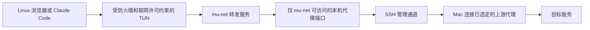

# 连接复用故障与代理通道

日期：2026-10-11。本项只覆盖 Linux 严格透明代理模式。

## 原因范围与方案

冻结 b3b92b6 包的两次持续网络诊断均出现连接超时。固定源端口对照
进一步复现：TUN 和 Lima 用户态网络两层各三个首次连接成功，两秒
后复用原四元组全部超时，等待 65 秒后全部恢复。切换 sing-box 自带
`system` TCP 模式后，内部三组复用全部成功，外层仍失败。此结果
确定了触发条件和受影响路径，没有把库内具体原因猜测作为已证事实。

现在使用标准系统 TCP 转发，并经现有 SSH 管理连接把代理数据交给
Mac 上用户指定的上游代理。浏览器 / Claude Code 和 TLS 仍在 Linux
内运行；SSH 不提供住宅 IP，也不把浏览器伪装成 Mac。

正常任务不能直连私有代理端口。先在内核安装端口访问限制，再通过
SSH 开放监听；绑定冲突会失败，不连接占用者。Linux 中不再给转发
服务保留物理网卡直连上游的例外。准备旧环境防护或停止环境时撤销
客体联网许可并关闭通道。通道失效时后台检查会隔离并停止 VM。

SSH 会话内的固定 Python 观察器读取所属宿主进程的输入管道。宿主
进程退出关闭管道后，观察器通过 pidfd 结束自己的 SSH 会话和所有
转发连接，避免遗留监听或误杀被重用的 PID。此路径不依赖 Apple
Network Extension，不扩大为对其他 Mac 应用的网络防护。

## 当前候选与实测

候选 `release/proxy-transport-guard-candidate/mac-arm64/MuCodeSandbox.app`，
CDHash `7395e50362e01c36299c4eacabe0cbedb636cf22`。151 项源码测试、
类型 / 构建通过；完整性验证 6042 个封存资源，实际篡改拒绝通过。
这是本机临时签名，未获得 Apple 正式签名、公证或扩展授权。

21:43:52–21:46:03 UTC 使用此包的 45 个后台模块与全新受保护 VM
运行固定端口 / 生命周期专项；21:48:35 UTC 独立复核通过：

- TUN 和 SSH 私有代理各三次首次连接、三次两秒后端口复用全部成功。
- 两次正常启动均在实际创建 SSH 转发之前检查内核限制已存在、监听
  尚未开放；普通开发用户直连私有入口失败。
- 转发服务直接连接原物理代理地址失败，未保留物理出口例外。
- 实际 SIGKILL 所属 Node 测试进程后，真实 SSH 进程消失、客体监听
  删除、活动流结束、宿主消息计数停止。
- 关闭实际产品代理通道触发管理器自动停机；正常重启后连接和防护恢复。
- 首次 / 恢复开机及两份任务抓包的物理外发为 219 / 264 / 277 / 21，
  未批准外发均为 0；外发任务经批准 SSH 路径，没有物理代理连接。
- 临时 VM、基础镜像和数据已删除，原核心运行 VM 保留。

报告 `network-port-reuse-transport-candidate.json` 与同名
`-evidence.json`，报告 SHA-256
`7c1cae10844df0084af039c4d6ee6d48eb98580fe68cb10b3e178a20b3f919b1`；
原始目录 `network-port-reuse-transport-candidate-1791668632377/`。
源码、包内模块和原始产物哈希均核验。报告将端口回归通过和长期稳定性
分开，`portReuseFixVerified: true`，`stabilityPassed: false`。

此前试验和测试脚本失败原始目录保留，不覆盖为成功。所有临时资源
清理；没有修改或编译浏览器内核，也没有真实 Claude 账号或付费调用。

## 持续网络复测

21:47:06–21:59:19 UTC 同一冻结包完成两段各五分钟观察及主动故障；
21:59:29 UTC 独立复核通过。稳定观察共 609,773 ms，605 次新增短
请求、2,422 条新增流消息，两段新增请求 / 流错误均为 0。主动断线
阶段的预期错误单独记录，没有删除或算入正常阶段。

代理断线阻断新连接和已有连接，拒绝直连；恢复无需重启 VM。网络服务
重启 / 续租恢复、转发服务停止后的自动隔离、手动正常重启均通过。
首次 / 任务 / 恢复开机 / 恢复任务四份抓包物理外发为
265 / 8,547 / 261 / 22，未批准均为 0，物理代理连接均为 0。
临时资源清理。报告 `sustained-network-transport-candidate.json` 和
对应 `-evidence.json`，SHA-256
`f4edb135d31ef6dfff4a661561d90820ba94d69606ae43f830af10bd52733e83`；
原始目录 `sustained-network-transport-candidate-1791668825805/`。
这是数字地址 TCP / 流式短期稳定验收，测试代理拒绝 DNS 目标，不能
作为成功域名解析或全天稳定性证据。

## 尚未扩大验收

同包 HTTPS 上游证书 / 名称 / 认证 / 断线 / 恢复和明文抓包对照已于
22:06 UTC 独立复核通过；系统域名解析 / DoH 故障 / 恢复、22 个不同
域名和六份抓包于 22:08 UTC 通过。见 [HTTPS](encrypted-upstream-validation.md)
与 [DNS](domain-network-validation.md)。SOCKS5 双 VM 认证 / 无认证 /
DNS / 公共 HTTPS / 断线 / 重启及七阶段抓包于 22:12 UTC 独立复核
通过，见 [SOCKS5](socks-upstream-validation.md)。以上临时资源均清理。
7395e50 的出口 IP 锁定在业务许可开放前检测超时，应用拒绝启动。
9378141 候选以限制 UID 的本地检测入口修复；包内真实 VM / 五份物理
抓包专项于 22:29 UTC 独立复核通过。新包桌面于 22:37 UTC、十分钟
持续网络于 22:43 UTC 各独立复核通过，共另十份抓包未批准外发 0；
不把旧 gVisor 结果或本页其他7395e50结果自动转移。
见 [失败记录与修复](egress-probe-validation.md)。

当前候选实际 Electron 浏览器 / CLI / 快照 / 加密导入完整流程已于
21:55:27 UTC 独立复核通过，六份抓包未批准外发 0，临时资源清理。
详见 [完整流程](packaged-workflow-validation.md)。持续网络结果见上节。
尚不能把旧 b3b92b6 的全部专项转移到当前包。
本项不包括实际 Electron 主进程 SIGKILL、实际 Mac 切网 / 休眠、
一天运行、真实住宅线路或第二台 Mac；WireGuard 和非透明应用代理
不使用本次 SSH 路径，原验收范围保持不变。
