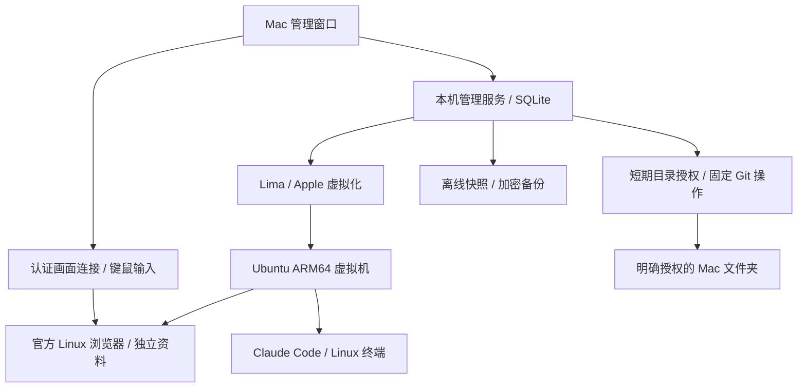

# MuCodeSandbox 技术方案总览

2026-10-12 0.4.17 当前方案：保留多个查看 / 终端实例，轻量Openbox管理共享客体显示；私有短时链接队列接受HTTP(S)及固定客户端返回协议，不回退宿主浏览器；限定文件夹和手动文本传输，没有自动宿主剪贴板同步。按用户选择使用basic凭据后端，不提供钥匙环加密。见 [设计](plans/2026-10-12-guest-workspace-handoff.md) 和 [限定验证](guest-workspace-handoff-validation-2026-10-12.md)。

2026-10-12 当前更新：0.4.10 / 8053dd4051aba726。当前桌面路线和资料清理见 [桌面方案](managed-desktop-design-2026-10-12.md)，限定验收与未覆盖项见 [桌面报告](managed-desktop-validation-2026-10-12.md)。下文阶段版本保留历史记录。

更新日期：2026-10-11（台北时间）。这是当前路线的汇总；详细实现、
历史方案和验证原件通过 [文档总目录](README.md) 查阅。

准确项目路径、文件结构和实际运行状态统一见 [项目总览与交接](../PROJECT_OVERVIEW.md)。
安装构建为 `7c2737978926f345`；当前用户目标保持 Linux VM，优先检查
命令行直接系统识别及数据发送。五轮已有实际读取 / 回执证据，见
[CLI 环境审计](cli-environment-audit-2026-10-11.md)。审计脚本尚不是桌面常驻功能。

## 目标与当前范围

在 Apple Silicon Mac 上管理彼此独立的开发环境，先支持 Linux
虚拟机内的官方浏览器和 Claude Code。第一轮测试使用本地服务、
合成登录和模拟模型，不登录真实 Claude 账号、不调用付费模型。

当前交付为 0.4.5 本机测试包，安装在 `~/Applications/MuCodeSandbox.app`，
桌面快捷入口指向该副本。新增浏览资料重置、帮助与网络向导、实时防护、
无账号检测及玻璃布局。0.4.2 修正窗口滚动 / 卡片适配，并增加沙箱浏览器
独立窗口入口。0.4.3 将加载进度移入画面区域，新增本地浏览器首页；
IP 查询由浏览器直接请求公开 HTTPS 服务，不新增端口或宿主权限。
构建和限定验证范围见 [首页验证](browser-home-validation.md)。
0.4.4 在日志页增加出口双回执观察、透明代理的连接 / DNS 元数据，
采集内容本地限量保存；不是逐连接公网出口证明，见 [网络日志验证](network-observations-validation.md)。
0.4.5 使用 Ubuntu TigerVNC 和原生 DPI 配置，让客体桌面实际像素随查看窗口
及宿主像素密度调整，替代固定小画面拉伸。沿用官方浏览器；不修改内核，
不改变宿主显示设置，不增加开放端口：[清晰度验证](retina-display-validation.md)。
0.4.0 的 `9621b0a` 原件及其 13 项验收保留为历史证据，不自动转为新包结果。
整个目标尚未完成；Apple 正式签名、公证、发行更新和部分现场验收未完成。
Claude Desktop、macOS VM、本机 Mac 浏览器强制出口按用户决定暂缓。

## 组件与运行位置

React 是界面，Electron 提供桌面窗口与原生选择器；TypeScript 本机
服务负责操作，SQLite 存储配置和任务。Lima 使用 Apple
Virtualization.framework 运行 Linux，复用现成虚拟化能力。
不是从参考应用复制后端，也不自行开发或编译浏览器内核。

## 网络方案

| 模式 | 路径 | 防护边界 |
| --- | --- | --- |
| 直连 | Linux 默认网络 | 不提供强制代理防护 |
| 严格应用代理 | 工具遵守代理配置，客体防火墙拒绝其余出口 | 不支持代理的工具可能连接失败 |
| 严格透明代理 | TCP / DNS → TUN / sing-box → 受限 SSH 通道 → Mac 连接批准的上游 | 其他业务 UDP / IPv6 阻断，无直连备用出口 |
| WireGuard | 客体内核隧道 → 指定对端 | 当前支持范围为 IPv4 TCP 与受控 DNS，其他业务 UDP / IPv6 阻断；界面仍标为测试 |

HTTP / SOCKS5 不加密连接代理这一跳；HTTPS 代理校验证书名称与信任，
没有忽略证书错误的降级选项。DNS 使用验证 TLS 的受控 DoH。
宿主管理 SSH、DHCP、专用检测和隧道外层有明确例外，不应把它们
计为“全部包都走网页代理”。最终住宅 / 公网出口仍需真实线路验证。

出口锁定在开放业务访问前核验批准 IPv4，并后台重测；错误、变化或
无法测量时撤销访问并停机。定时测量不是每条连接的公网出口证明。

## 启动与持续防护

1. 基础镜像提前安装保守规则，用户 VM 首次启动继承默认拒绝。
2. 校验开机文件、规则、路由、DNS、组件及必要权限。
3. 需要锁定出口时，先由专用检测身份核验，不先开放业务许可。
4. 通过后开放浏览器、终端及获批桥接；内核联网许可最多有效 45 秒。
5. 管理器约每 8 秒复核完整性，通过才续期；异常撤销相关访问并停机。

主进程消失时许可不能继续续期；已有测试验证选定故障下旧流与新流
阻断和到期关闭。45 秒许可及周期检查存在时间窗口，不承诺瞬时阻断。
客体内的防火墙和监测不是抵抗客体 root 完全失陷的外部强制边界。

宿主网络监测组件检查网络变更、死亡和卡死；桌面接入真实休眠事件。
真实休眠尝试未能完成系统管理员认证，实际切网也未验收，不能用注入
事件的成功替代。真实断电和独立于客体的全程首包捕获仍暂缓。

## 浏览器与环境特征

采用固定版本与摘要的官方 Linux ARM64 浏览器，普通 dev 用户运行。
当前具体发行版是 Chrome for Testing 156，供本机无账号测试，不自动更新。
日常使用前的稳定发行版选择与更新维护仍待办，见 [最新环境核对](account-environment-review-2026-10-11.md)。
浏览器保留 Chromium 沙箱、独立资料和运行中保护检查。Mac 通过认证远程
画面显示浏览器，传递输入；VNC / CDP 不作为任意公网接口开放。

系统 locale、时区、页面 / Worker 配置及请求头按环境设置应用；保留
实际 Linux、字体、Canvas 和图形渲染器信息，可能软件绘制。
用户目标是正常的 Linux 个人电脑环境。虚拟设备、软件图形、系统可见信息
与物理 Linux 电脑存在差异；不承诺完全不可识别虚拟化或平台账号安全。

官方浏览器版本更新走安装与资料恢复事务，已有 153 → 156 的当前包
专项。后台晚注册字体与强制 GPU 故障后原画布恢复的研究失败记录保留，
不再以浏览器内核改造作为本项目完成条件；自动浏览器升级未交付。

## 命令行的系统读取与发送

CLI 安装入口和终端已实现，但当前越南用户目录尚未安装 Claude Code。
审计将官方 2.1.296 放在独立临时目录，空白资料与回环测试网络中运行。
客户端实际探测虚拟化 UUID / 容器并读取内核 / 机器标识；默认请求含环境
类别。关闭非必要遥测不停止全部读取或必要请求中的系统信息。若授权
Bash 执行系统查询，`apple` 结果能进入后续模型请求。
五轮共 53 条记录 / 9 条校准。进一步实测：Read 路径拒绝不覆盖所测
Python 间接读取；本地 MCP 工具被拒绝时，已配置的后台服务仍可启动。
服务启动时的读取与进入模型请求的数据分开记录；不能用工具规则代替
整个进程的文件访问边界。
已配置的启动 hook 还可以在没有模型工具调用时把系统名称加入首次请求。
默认 API 错误 / 重试事件中有环境与诊断字段；本地测试 CA 和服务器
特征单独标注，不解释为日常线路异常，真实订阅错误报告仍未验证。
Remote Control 无账号时在订阅门槛退出；其独立 UUID、hostname 和可选
host profile 仅核对了静态结构，登录后实际注册仍未验证。
这些是版本绑定的有限观察，不证明官方据此封号；更多功能 / 认证路径继续检查。
详见 [审计范围](cli-environment-audit-2026-10-11.md)。

## 权限、文件与宿主桥接

Linux 管理账户、开发账户和网络服务分开。dev 不具有任意 sudo 权限，
包安装仅走固定允许入口。默认不共享整个 Mac 主目录，不转发 SSH agent。

持续共享目录通过显式 virtiofs 配置，默认只读，增加 nosuid / nodev
等限制。目录读写会直接作用于 Mac 文件，快照不包含这些外部文件。

短期桥接按目录、读写、有效时间和固定命令分别批准。文件接口使用
目录描述符锚定，拒绝路径逃逸和符号链接，撤销或停机后失效。
命令仅支持 Git 状态 / 差异 / 最近提交，固定参数、只读、禁止联网，
时间与输出有上限。不是任意宿主 shell 或整机控制。

## 本机管理与凭据

管理服务只绑定 `127.0.0.1`。私有启动链接建立 HttpOnly 会话，API
另要求认证与来源校验。前端无 Node 权限，Electron 开启隔离和沙箱。
同一数据目录独占运行，生命周期操作按环境串行处理。

默认数据目录为 `~/.mucodesandbox`，可显式覆盖；实际位置以“系统设置”
为准。代理秘密使用 AES-256-GCM 存储，密钥和数据库限制文件权限，
日志脱敏。不能抵御同一 macOS 用户权限下的恶意程序。
终端键盘输入和输出不作为常规应用日志持久保存。

## 快照、备份与磁盘恢复

离线快照保存 Linux 磁盘及必要配置，使用 HMAC 清单、SHA-256、
同步落盘、恢复记录和回滚预检。恢复时占用环境锁，拒绝并发危险操作。
已验证选定进程强退与界面恢复；整机断电、存储硬件损坏不在已验范围。

便携备份使用 AES-256-GCM / scrypt，加密认证后才发布导入环境，
解析限制归档路径、类型、大小和内容摘要，支持稀疏磁盘。
导入产生新环境 / 虚拟硬件身份及管理密钥，不继承宿主共享、端口和
桥接授权；磁盘仍含原应用资料，不宣称重建全部客体标识。
同机独立数据目录导入已验，第二台 Mac 未验。

停机扩容与中断恢复保留文件，已有旧满盘样本和三个维护进程中断点
的当前包专项。虚拟磁盘标称容量不等于实际物理占用；快照、备份、
运行镜像和应用各自占空间。不要把源码、虚拟机和历史应用包视为同一类文件。

## 无账号测试与证据规则

本地平台提供 DNS / STUN 接收端、请求回执、合成会话和模拟 Messages
服务，官方 CLI 使用本地测试配置执行流式、工具许可、取消与恢复。
测试程序使用独立数据目录和临时 VM，不复用真实账户。

验收必须关联包签名、模块摘要、输入、原始回执、抓包、故障时序和
清理记录。独立复核检查这些证据，而不是只看验证器输出“通过”。
当前完整性审计绑定 13 项当前包已记录范围，不能扩大为全功能完成。
抓包中未批准外发为 0 只适用于各自接口、时间窗口与允许列表。

`npm run audit:local-delivery` 核对已有材料，写入
`test-results/local-delivery-audit.json`，不会启动新的真实验收。
真实测试命令可能创建 VM、下载组件、请求管理员认证或等待一天，
不应把 `package.json` 中所有命令当成日常使用步骤逐个运行。

## 分发和后续范围

当前应用为临时签名，不具备 Apple 正式发行身份、公证和受信任更新链。
使用 Linux VM 不以本机 Network Extension 签名为前提；若恢复本机
Mac 浏览器系统级出口路线，需要重新实现、签名和实机验收。

正式分发、自动更新、更多平台和 Claude Desktop 尚未交付。竞品官网、
静态拆包与本项目实测是不同证据，不确认双方防护强度等同。
完整未完成项、恢复条件和验证方式见 [统一待办](TODO.md)。

## VPS + 静态住宅出口（2026-10-11 新方向）

用户已选择以 VPS 中转、静态住宅代理作最终出口。先用专用本机端口接入，保留现有客体 TUN / 受控 DNS / 严格防火墙与出口变化关闭。VPS 不得在住宅失败时改走机房直连。线路参数尚未提供，远程部署未进行。详细步骤见 [网络方案](network-vps-static-residential-plan.md)。
